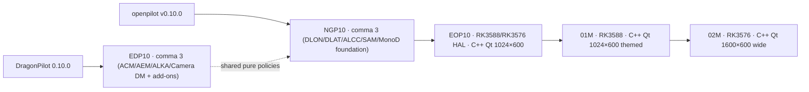

<div align="center" style="text-align: center;">

<h1>ExoPilot EOP10 🚀</h1>

<p>
  <b>Advanced ADAS for Rockchip RK3588 / RK3576 built on openpilot v0.10.0 + NGP10 portable foundation, multi-camera RKNN/Hailo/DX perception, corner/forward radar, BrownPanda gateway, and native C++ Qt UI.</b>
</p>

<h3>
  <a href="#feature-comparison">Features</a>
  <span> · </span>
  <a href="#-highlight-features">Highlights</a>
  <span> · </span>
  <a href="#-branches">Branches</a>
  <span> · </span>
  <a href="#-how-to-install">Install</a>
  <span> · </span>
  <a href="docs/CARS.md">Cars</a>
  <span> · </span>
  <a href="docs/SAFETY.md">Safety</a>
  <span> · </span>
  <a href="https://github.com/exo-elec/openpilot/issues">Issues</a>
</h3>

[](LICENSE)
[](https://github.com/exo-elec/openpilot/tree/dev/EOP10)
[](https://github.com/exo-elec/openpilot/commits/dev/EOP10)
[](https://github.com/exo-elec/openpilot/issues)

</div>

---

## Using ExoPilot in a car

To use **ExoPilot** in a car, you need four things:

1. **Device:** an **ExoPilot 01M (RK3588) or 02M (RK3576) device**, with its matching build profile.
2. **Software:** the matching branch (`dev/EOP10`, `dev/01M`, or `dev/02M`). See *How to Install* below.
3. **Car:** a supported car via BrownPanda gateway. See [docs/CARS.md](docs/CARS.md).
4. **Harness:** the vehicle harness connecting the device to the car.

ExoPilot is in active development and has not been road-certified on a real vehicle. Read [docs/SAFETY.md](docs/SAFETY.md) before driving.

---

<a id="feature-comparison"></a>

## Feature Comparison: openpilot → EDP10 → NGP10 → EOP10 → 01M → 02M

**Reviewed:** 2026-11-28 · **Reference:** openpilot v0.10.0 (`c085b8af19`) · **Lineage gate:** [`exopilot/tools/lineage.py`](exopilot/tools/lineage.py) (**128 portable Python files** match `dev/NGP10` byte-for-byte across `EOP10 → 01M → 02M`).



### Platform, Vehicle Integration & Display

| Capability | openpilot v0.10.0 | EDP10 | NGP10 | EOP10 (this branch) | 01M | 02M |
|---|---|---|---|---|---|---|
| Platform / SoC | comma 3/3X | comma 3/3X | comma 3/3X | **Rockchip RK3588 / RK3576 HAL** | RK3588 default | RK3576 default |
| Vehicle interface | `card` + OpenDBC | `card` + vendored OpenDBC (BYD/Chery) | `card` + pinned OpenDBC | **`socketd` + Tesla DBC + BrownPanda gateway** | Carried | Carried |
| UI backend | Native C++ Qt | DragonPilot C++ Qt | Native C++ Qt (`features_panel`) | **Native C++ Qt (`1024×600`, `exopilot_panel` + `MapdAreaRows`)** | Native C++ Qt (`1024×600` themed) | Native C++ Qt (`1600×600` wide) |
| Driving inference | Tinygrad (QCOM) | Tinygrad (QCOM) | Tinygrad + Phone BigModel | **Split RKNN (`driving_vision` + `driving_policy`) + ONNX PC + Phone BigModel** | Carried | Carried (RK3576 RKNN) |
| Multi-camera & accel card | Front + Wide | Front + Wide | Front + Wide + exp `monod` | **RKNN YOLO (road/tele/side/rear @ 20 Hz) + Hailo-8 / DX-M1M `segd` drivable** | Carried (7 cam) | Carried (8 cam + tele) |
| Phone link | — | — | PLP v5 USB/TCP (`plpd`) | **PLP v5 USB/TCP + BLE GATT + legacy NCP v4.1** | Carried | Carried |

### Cruise, Braking & Speed Controllers

| Feature | openpilot v0.10.0 | EDP10 | NGP10 | EOP10 / 01M / 02M | Proven Reference / Design |
|---|---|---|---|---|---|
| Longitudinal foundation | Stock ACC / EXP | `ACM` + `AEM` | **Adaptive `DLON`** (ACC↔E2E + force-stop) | **Carried byte-identical** + EOP planner wiring | FrogPilot CEM / Sunnypilot |
| Profiles, adaptive gap & TJA | Stock personalities | `speed_zones` + `dp_tja` | Eco/Normal/Sport + `adaptive_follow_gap` + `TJA` | **Carried** (shared `exopilot/.../tja.py`) + `DriverPrefs` | FrogPilot / ExoPilot |
| **VTSC** (Vision Turn Speed) | ❌ | ✅ opt-in | ✅ `vtsc.py` | **Carried** + learned comfort (`TSCTargetLatAccel*`) | Sunnypilot SCC-V + FrogPilot |
| **MTSC** (Map Turn Speed) | ❌ | ✅ opt-in | ✅ `mtsc.py` + `blend_mtsc_vtsc` | **Carried** + `cslb` learned curve speeds + offline `mapd` | `pfeiferj/openpilot-mapd` |
| **MSLC / NSLC** (Speed Limits) | ❌ | ✅ MSLC | ✅ `SpeedLimitPolicy` (`LOWEST`) + `SLCOffset1..7` | **Carried** + upstream `navd` + spoken pre-announce | FrogPilot SLC + offline `mapd` |
| **TLSC** (Traffic Light Stop) | ❌ | ❌ | ✅ `tlsc.py` + virtual stop-line MPC (`3.0 m` buffer) | **Carried** + RKNN road YOLO HSV classifier (`monod` → `gridd`) | CarrotPilot / FrogPilot stop-line MPC |
| **BRSC** (Bumpy Road Speed) | ❌ | ✅ | ✅ `brsc.py` (`-v[0]` vertical IMU + finite/dropout guards) | **Carried** + `SQSC` surface quality DB (`Paths.persist_root()`) | ExoPilot shared policy |
| **DDSC / RCSC** | ❌ | ❌ | ✅ `ddsc.py` (SAM) + `rcsc.py` | **Carried** + `surfaced` road-condition inputs | ExoPilot |
| **RSS AEB & LHLC** | FCW only | FCW only | — | **Optional RSS AEB** (forward UART `radar3d`) + **LHLC** 500 m `pathd` | ExoPilot |

### Lateral, Monitoring, Radar & Perception Ownership

| Feature | openpilot v0.10.0 | EDP10 | NGP10 | EOP10 / 01M / 02M | Proven Reference / Design |
|---|---|---|---|---|---|
| Lateral foundation | Stock LKAS | `ALKA` + DP `RED` | **Adaptive `DLAT` + `ALCC`** | **Carried byte-identical** + `DesireHelper` live `modelV2` gates | Sunnypilot MADS / DLP |
| **RED / SOC / CAT / LCA** | Basic LCA | RED + CAT + LCA guards | `road_edge` + `soc` + `cat` + `lane_gap` + `lc_lead_handoff` | **Carried** + surround camera/radar inputs | DragonPilot / Sunnypilot / ExoPilot |
| **Blinker Pause & Resume Ramp** | ❌ | ✅ | ✅ `blinker_pause.py` + `steering_policy.py` | **Carried** | Sunnypilot blinker-pause |
| **Driver Monitoring** | Camera DM | Camera DM | **SAM** (`driveractivityd` 20 Hz, no camera DM) | **Carried byte-identical** | ExoPilot SAM |
| **Radar3D / Radar4D / Radar2D** | OEM radar | OEM radar | Planar `radar2d` contract | **77 GHz UART `radar3d` + BLE `radar4d` (`radar2d` view) + 02M Wi-Fi** | ExoPilot |
| **GridD / SegD / PathD / DPP** | ❌ | ❌ | Portable `monod`/`gridd`-lite/`pathd` | **Full BEV `gridd` (`leadsV3` + `DrivableFusion`) + `segd` + `pathd`/`DPP`** | ExoPilot |

---

## 🌟 Highlight Features

| | Feature | Behavior |
|---|---|---|
| 🧠 | **Shared NGP10 Core (`lineage.py` 128/128)** | Adaptive `DLON`, `DLAT`, `ALCC`, `SAM`, `VTSC`, `MTSC`, `MSLC`/`NSLC`, `TLSC`, `BRSC`, `DDSC`, `RCSC`, `TJA`, and `DPP` flow byte-identical from `dev/NGP10` into `EOP10 → 01M → 02M` |
| 🚦 | **End-to-End TLSC Red-Light Stopping** | `monod` road YOLO + HSV lamp classifier → `gridd` `stereoObjects` (`trafficLight`) → `LongitudinalPlanner` virtual stop-line MPC (`3.0 m` stop buffer, full standstill hold, immediate green/gas release) |
| 👁️ | **RKNN Detects, Card Segments** | YOLOv8 runs on on-die RKNN across road/side/rear cameras (20 Hz); optional Hailo-8 or DX-M1M runs TwinLiteNet+ drivable segmentation via `segd` → `gridd` `DrivableFusion` and degrades gracefully if absent |
| 📡 | **Dual-Layer Vehicle Safety & Radar** | `socketd` Tesla-DBC adapter + `SafetyManager` (Layer 1) backed by BrownPanda hardware gateway (Layer 2), paired with forward 77 GHz UART `radar3d` and BLE surround `radar4d`/`radar2d` |
| 🖥️ | **Unified C++ Qt UI & Rockchip HAL** | Native C++ Qt UI compiled via SCons (`1024×600` on `EOP10`/`01M`, `1600×600` on `02M`) with independent `RK3588Hardware` & `RK3576Hardware` adapters, exact NUL-delimited DT detection, and correct A55 (`0–3`) / A76·A72 (`4–7`) core affinity |

---

### 🧪 Host Simulation & MetaDrive Verification (2026-11-28)

Verified on Linux host PC (Ryzen 7 7840HS + NVIDIA RTX 4050 Laptop GPU + PoCL 5.0 OpenCL):
- **Build & Gate**: `scons -j8 cereal common selfdrive/ui/ui selfdrive/ui/tests/ui_snapshot` clean; offscreen C++ Qt `ui_snapshot` rendered `1024×600` PNG; `lineage.py` **128/128** match `dev/NGP10`; `./test.sh` **74/74** hardware + lint + shebang passed; `test_boundaries.py` **4/4** passed.
- **Unit, Integration, Closed-Loop & Regressions**: **`1,023 passed`** across `exopilot/tests/`, `selfdrive/controls/tests/`, and `system/inferenced/tests/`, plus **`57/57`** `tools/sim/tests/run_tests.py` and **`657+`** messaging/recordd/build-profile/simulated-component checks (zero failures).
- **MetaDrive 3D Behavioral Suite** (`exopilot/tests/test_eop10_metadrive_loop.py`, WSLg RTX 4050 EGL + PoCL OpenCL `CameraSim` → `v4l2d` VisionIPC):
  - **VTSC + DLON + DLAT + CameraSim**: R=60 m curve slowdown & straight exit recovery, 100% in-lane, DLAT laneful↔laneless arbitration, DLON sharp-curve trigger, OpenCL NV12 VisionIPC streaming.
  - **TLSC P0 Safety**: virtual stop-line MPC stops MetaDrive car cleanly before 60 m red light (`x <= stop_line`, `v < 0.5 m/s`), holds standstill, and immediately accelerates on confirmed green.
  - **MTSC + MSLC/NSLC (`SpeedPolicy.LOWEST`)**: caps MetaDrive speed to lower posted limit (36 km/h vs 50 km/h) and recovers cleanly when limits rise.
  - **BRSC & Brake Release**: rejects longitudinal `v[2]` excitation, slows on vertical `-v[0]` roughness, resets immediately on IMU dropout, and never throttles brake release from `-2.5 m/s²`.
  - **Live Tesla CAN Checksums + GridD `leadsV3` & `DrivableFusion`**: `SimulatedCar` (`CANPacker("tesla_model3_party")`) round-trips live MetaDrive speed/blinkers through `CarState.update()`; `GridD._fuse_modeld_detections` fuses real `leadsV3` with single `yRel = -y` flip; `DrivableFusion` shifts road log-odds with live ego speed.

---

## 🔧 Branches

| Branch | Install | Description | Recommended For |
|---|---|---|---|
| `dev/EDP10` | `git clone -b dev/EDP10` | DragonPilot `ACM`/`AEM`/`ALKA` + Camera DM + BYD/Chery Panda + VTSC/MTSC/MSLC/BRSC | comma 3/3X DragonPilot users |
| `dev/NGP10` | `git clone -b dev/NGP10` | Portable adaptive `DLON`/`DLAT`/`ALCC`/`SAM`/`MonoD` + BigModel + PLP v5 | comma 3/3X ExoPilot users |
| `dev/EOP10` | `git clone -b dev/EOP10` | Shared Rockchip RK3588/RK3576 ExoPilot base (`1024×600` C++ Qt) | ExoPilot developers |
| `dev/01M` | `git clone -b dev/01M` | Shared EOP features with themed `1024×600` C++ Qt UI on RK3588 | ExoPilot 01M owners |
| `dev/02M` | `git clone -b dev/02M` | Shared EOP features with wide `1600×600` C++ Qt UI on RK3576 | ExoPilot 02M owners |

All three EOP branches share one runtime tree; `common/build_profile.py` selects the UI backend, default SoC, and display size. See [docs/eop/SHARED_PIPELINE.md](docs/eop/SHARED_PIPELINE.md).

---

## 🧰 How to Install

```bash
git clone -b dev/EOP10 https://github.com/exo-elec/openpilot.git
```

Install the ExoPilot BSP on real RK3588 hardware first (`sudo ~/pilot/exopilot/scripts/install/setup_rk3588.sh && sudo reboot`).

---

## 📋 Credits & Proven References

- **[commaai/openpilot](https://github.com/commaai/openpilot)**: openpilot v0.10.0 foundation (MIT)
- **[DragonPilot](https://github.com/dragonpilot-community/dragonpilot)**: ROAD edge / UX concepts
- **[sunnypilot](https://github.com/sunnypilot/sunnypilot)**: SCC-V vision curve control, MADS/DLP lateral patterns, blinker-pause, frame conventions
- **[FrogPilot](https://github.com/FrogAi/FrogPilot)**: CEM/DLON dynamic profiles, speed-limit offsets & confirmation, adaptive following gap, lead departure notice
- **[CarrotPilot](https://github.com/sunnyhaibin/carrotpilot)**: virtual stop-line lead MPC pattern for traffic-light stopping
- **[pfeiferj/openpilot-mapd](https://github.com/pfeiferj/openpilot-mapd)**: offline OSM map data daemon (`third_party/mapd/`)

---

## ⚖️ Safety and Legal

- **ExoPilot** is a modified version of **openpilot v0.10.0** by comma.ai (MIT license, see [LICENSE](LICENSE)). It is not made, endorsed, or supported by comma.ai.
- **There is no camera-based driver monitoring on NGP10/EOP10/01M/02M.** SAM (`driveractivityd`) only monitors steering/pedal input; always watch the road and keep hands ready to take over.
- **ALPHA RESEARCH SOFTWARE — NOT ROAD-CERTIFIED. NO WARRANTY EXPRESSED OR IMPLIED.**
