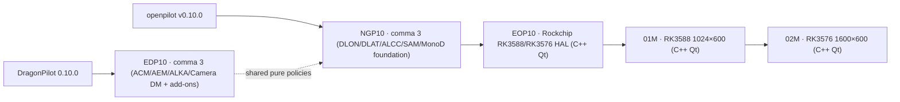

<div align="center" style="text-align: center;">

<h1>ExoPilot NGP10 🧭</h1>

<p>
  <b>Adaptive DLON / DLAT / ALCC / SAM / MonoD openpilot v0.10.0 baseline for comma 3 / 3X — the portable foundation for EOP10, 01M, and 02M.</b>
</p>

<h3>
  <a href="#feature-comparison">Features</a>
  <span> · </span>
  <a href="#-highlight-features">Highlights</a>
  <span> · </span>
  <a href="#-branches">Branches</a>
  <span> · </span>
  <a href="#-how-to-install">Install</a>
  <span> · </span>
  <a href="docs/CARS.md">Cars</a>
  <span> · </span>
  <a href="docs/SAFETY.md">Safety</a>
</h3>

[](LICENSE)
[](https://github.com/exo-elec/openpilot/tree/dev/NGP10)
[](https://github.com/exo-elec/openpilot/commits/dev/NGP10)
[](https://github.com/exo-elec/openpilot/issues)

</div>

---

## Using ExoPilot NGP10 in a car

1. **Device:** a **comma 3 / 3X** (Snapdragon 845).
2. **Software:** `dev/NGP10` — portable ExoPilot foundation built on **openpilot v0.10.0** (`c085b8af19`).
3. **Car:** a supported car (see [docs/CARS.md](docs/CARS.md)).
4. **Harness:** matching vehicle harness.

ExoPilot has not been road-certified on a real vehicle. Read [docs/SAFETY.md](docs/SAFETY.md) before driving.

---

<a id="feature-comparison"></a>

## Feature Comparison: openpilot → EDP10 → NGP10 → EOP10 → 01M → 02M

**Reviewed:** 2026-11-28 · **Reference:** openpilot v0.10.0 (`c085b8af19`) · **Lineage gate:** [`exopilot/tools/lineage.py`](exopilot/tools/lineage.py) (portable `exopilot/` Python modules flow byte-identical `NGP10 → EOP10 → 01M → 02M`)



> **Architectural distinction (`EDP10` vs `NGP10`):** `EDP10` keeps DragonPilot's `ACM`/`AEM`/`ALKA` + camera DM foundation with opt-in add-ons (`VTSC`/`MTSC`/`MSLC`/`mapd`/`BRSC`). `NGP10` replaces the longitudinal/lateral/monitoring foundation with **adaptive `DLON` + `DLAT` + `ALCC` + `SAM` (`driveractivityd`) + `MonoD`/`GridD-lite`/`PathD`/`DPP`** before layering all speed and map add-ons on top.

### Platform, Vehicle Interface & Display

| Capability | openpilot v0.10.0 | EDP10 | NGP10 (this branch) | EOP10 | 01M | 02M |
|---|---|---|---|---|---|---|
| Hardware target | comma 3/3X | comma 3/3X | comma 3/3X | Rockchip RK3588/RK3576 | RK3588 | RK3576 |
| Vehicle interface | `card` + OpenDBC | `card` + vendored OpenDBC (BYD/Chery) | `card` + pinned OpenDBC | `socketd` + BrownPanda gateway | Carried | Carried |
| UI backend | Native C++ Qt | DragonPilot C++ Qt | Native C++ Qt + `features_panel` + `MapdAreaRows` | Native C++ Qt (`1024×600`) | Native C++ Qt (`1024×600` themed) | Native C++ Qt (`1600×600` wide) |
| Phone BigModel & PLP v5 | ❌ | ❌ | ✅ USB/TCP `plpd` + one-way RKNN/Tinygrad fallback | ✅ USB + BLE GATT | Carried | Carried |

### Longitudinal Foundation & Speed Controllers

| Feature | openpilot v0.10.0 | EDP10 | NGP10 | EOP10 / 01M / 02M | Reference / Design |
|---|---|---|---|---|---|
| Longitudinal foundation | Stock ACC / EXP | DragonPilot `ACM` + `AEM` | **Adaptive `DLON`** (always-on Highway/Urban/Dynamic ACC↔E2E arbitration + force-stop) | Carried byte-identical | FrogPilot CEM / Sunnypilot |
| Acceleration profiles & adaptive gap | Stock personalities | `speed_zones` + `dp_tja` | Eco/Normal/Sport + `adaptive_follow_gap` + `speed_zones` + `TJA` | Carried | FrogPilot / ExoPilot |
| **VTSC** (Vision Turn Speed Control) | ❌ | ✅ opt-in | ✅ `vtsc.py` (0–250 m vision curvature) | Carried | Sunnypilot SCC-V + FrogPilot buckets |
| **MTSC** (Map Turn Speed Control) | ❌ | ✅ opt-in | ✅ `mtsc.py` + `blend_mtsc_vtsc` (150–500 m, 3.0 s hold) | Carried + learned speeds | `pfeiferj/openpilot-mapd` + ExoPilot |
| **MSLC / NSLC** (Posted Speed Limits) | ❌ | ✅ MSLC | ✅ Unified `SpeedPolicy` (`LOWEST`), `SLCOffset1..7`, confirm | Carried + `navd` | FrogPilot SLC + offline `mapd` v2.4.0 |
| **TLSC** (Traffic Light Speed Control) | ❌ | ❌ | ✅ `tlsc.py` + virtual stop-line MPC lead (`3.0 m` stop buffer, holds `0 m/s`, instant green release) | Carried + RKNN road YOLO | CarrotPilot / FrogPilot stop-line MPC |
| **BRSC** (Bumpy Road Speed Controller) | ❌ | ✅ | ✅ `brsc.py` (`-v[0]` vertical IMU, finite guards, IMU-dropout reset) | Carried | ExoPilot shared policy |
| **DDSC** (Driver-Decay Speed Cap) | ❌ | ❌ | ✅ `ddsc.py` fed by SAM awareness | Carried | ExoPilot |
| **RCSC** (Road Condition Speed Control) | ❌ | ❌ | ✅ Portable `rcsc.py` policy | Extended with `surfaced` / card | ExoPilot |
| **MonoD Cut-In & PathD / DPP** | ❌ | ❌ | ✅ Portable `monod` (Tinygrad YOLO) + `gridd`-lite + `pathd` + `PolicyArbiter` | Extended with RKNN + Hailo/DX + stereo/radar | ExoPilot |

### Lateral Foundation, Steering & Monitoring

| Feature | openpilot v0.10.0 | EDP10 | NGP10 | EOP10 / 01M / 02M | Reference / Design |
|---|---|---|---|---|---|
| Lateral foundation | Stock LKAS | DragonPilot `ALKA` + `RED` | **Adaptive `DLAT`** (Laneful/Laneless + DLP curve assist + LCA confidence gate) + **`ALCC`** (`alcc.py`) | Carried byte-identical | Sunnypilot MADS/DLP |
| **RED** (Road Edge Detection) | ❌ | ✅ DP RED | ✅ `road_edge.py` vision guard + laneless edge nudge | Carried | DragonPilot / ExoPilot |
| **SOC** (Smart Offset Control) | ❌ | ❌ | ✅ `soc.py` (bounded lateral bias away from adjacent vehicles) | Extended with radar/cameras | ExoPilot |
| **CAT** (Car Adaptive Tuning) | ❌ | ✅ opt-in | ✅ `cat.py` smoothed/validated `steerRatio` & `stiffnessFactor` | Extended with persistence | ExoPilot |
| **LCA Guards & Lead Handoff** | Basic LCA | ✅ opt-in | ✅ `lane_gap.py` (width/TTC) + `lc_lead_handoff.py` | Extended with surround radar | ExoPilot |
| **Blinker Pause & Resume Ramp** | ❌ | ✅ | ✅ `blinker_pause.py` + `steering_policy.py` (1.75 s ramp) | Carried | Sunnypilot blinker-pause |
| **Lead Departure & Green-Light Notice** | ❌ | Lead Depart | ✅ `lead_departure.py` + `green_light.py` | Extended with spoken prompts | FrogPilot / ExoPilot |
| **Driver Monitoring** | Camera DM | Camera DM | **SAM** (`driveractivityd` 20 Hz, speed-banded input availability; camera DM removed) | Carried byte-identical | ExoPilot SAM |

---

## 🌟 Highlight Features

| | Feature | Behavior |
|---|---|---|
| 🧠 | **Adaptive DLON + DLAT + ALCC Foundation** | Dynamic ACC↔E2E longitudinal switching (Highway/Urban/Dynamic), hysteretic laneful/laneless arbitration with DLP curve assist, and always-on lane centering |
| 🚦 | **Safe TLSC Virtual Stop-Line Stopping** | Feeds a stationary stop-line lead into `LongitudinalMpc` with a 3.0 m stop buffer so the vehicle stops cleanly before red lights, holds `0.0 m/s`, and releases immediately on green or gas override |
| 🗺️ | **Offline `mapd` v2.4.0 + VTSC / MTSC / MSLC / NSLC** | Vendored `third_party/mapd/` with deterministic 3.0 s hold, smooth MTSC→VTSC curve blending, and unified FrogPilot-style speed-limit offsets & confirmation |
| 👁️ | **Portable `MonoD` + `GridD-lite` + `PathD`/`DPP`** | Experimental Tinygrad YOLO road perception, cut-in speed trim, and bounded `PolicyArbiter` supervision flowing byte-identical down to Rockchip `EOP10` |
| 🛡️ | **SAM (`driveractivityd`) + BRSC + DDSC** | Speed-banded steering/pedal activity monitoring, comma-3 `-v[0]` vertical-IMU roughness control with finite/dropout guards, and unthrottled brake-release responsiveness |

### 🧪 Host Simulation & MetaDrive Verification (2026-11-28)

Verified on Linux host PC (Ryzen 7 7840HS + NVIDIA RTX 4050 Laptop GPU + PoCL 5.0 OpenCL):
- **Core unit, controls, longitudinal maneuvers, following distance, messaging & regressions**: `1,218 passed` (+ `58` subtests, including 62/62 `test_longitudinal.py` and 18/18 `test_following_distance.py`), C++ `common/tests/test_common` (`6,046` assertions / 7 cases) & `scons` C++ Qt UI (`selfdrive/ui/ui`) build clean.
- **MetaDrive 3D closed-loop behavioral suite** (`exopilot/tests/test_ngp10_metadrive_loop.py`, WSLg RTX 4050 EGL + PoCL OpenCL NV12 + VisionIPC):
  - **VTSC + DLON + DLAT + Camera Pipeline**: R=60 m curve slowdown & exit straight recovery, 100% in-lane, DLAT laneful↔laneless arbitration, DLON sharp-curve trigger, RTX 4050 → PoCL OpenCL NV12 → VisionIPC frames.
  - **TLSC P0 Safety**: stops cleanly before 60 m red light in MetaDrive physics (`x <= stop_line`, `v < 0.5 m/s`), holds standstill, immediately clears on confirmed green, accelerates through intersection.
  - **MTSC + MSLC/NSLC (`SpeedPolicy.LOWEST`)**: caps MetaDrive speed to the lower posted limit (36 km/h vs 50 km/h) and accelerates cleanly when limits rise.
  - **BRSC & Brake Release**: rejects longitudinal `v[2]` excitation, slows on vertical `-v[0]` roughness, clears immediately on IMU dropout, and never throttles brake release from `-2.5 m/s²`.
  - **SAM → DDSC + MonoD Cut-In + PathD/DPP + ALCC + SOC**: decays SAM awareness → slows distracted car via DDSC → recovers on `steeringPressed`; verifies cut-in braking, `SUPERVISE` arbitration, ALCC enablement, and SOC lateral offset.

---

## 🔧 Branches

| Branch | Hardware / Purpose | Status |
|---|---|---|
| `dev/EDP10` | Original comma 3 (DragonPilot `ACM`/`AEM`/`ALKA` + BYD/Chery + portable add-ons) | Development |
| `dev/NGP10` **(this branch)** | Original comma 3 / 3X portable ExoPilot foundation (`DLON`/`DLAT`/`ALCC`/`SAM`/`MonoD`) | Development |
| `dev/EOP10` | ExoPilot Rockchip RK3588/RK3576 HAL, RKNN/Hailo/DX perception, corner radar, C++ Qt | Development |
| `dev/01M` | ExoPilot 01M RK3588 `1024×600` native C++ Qt UI profile | Development |
| `dev/02M` | ExoPilot 02M RK3576 `1600×600` wide native C++ Qt UI profile | Development |

## 🧰 How to Install

```bash
git clone --branch dev/NGP10 https://github.com/exo-elec/openpilot.git
```

## 🐞 Bug Reports / Feature Requests

Open an issue on **[GitHub](https://github.com/exo-elec/openpilot/issues)** with branch, device, vehicle, reproduction steps, and logs.

## 📋 Credits

- [commaai/openpilot](https://github.com/commaai/openpilot): baseline openpilot v0.10.0 (MIT).
- [sunnypilot](https://github.com/sunnypilot/sunnypilot): reference concepts for vision turn speed (`SCC-V`), blinker pause lateral, and dynamic lane-confidence LCA gating.
- [FrogPilot](https://github.com/FrogAi/FrogPilot): reference concepts for curve comfort buckets, speed-limit bucket offsets/confirmation (`SLC`), adaptive acceleration profiles, conditional experimental switching, and README feature-table layout.
- [CarrotPilot](https://github.com/bulletmark/carrotpilot): reference pattern for stop-line longitudinal MPC braking (`TLSC`) and community BYD protocol insights.
- [dragonpilot](https://github.com/dragonpilot/dragonpilot): reference concepts for conservative road-edge and lane-change ergonomics.
- [pfeiferj/openpilot-mapd](https://github.com/pfeiferj/openpilot-mapd): vendored offline OSM `mapd` v2.4.0 binary & download menu.

---

## ⚖️ Safety & Legal

- **ExoPilot** is a modified version of **openpilot v0.10.0** under the MIT license (see [LICENSE](LICENSE)). Not affiliated with or endorsed by comma.ai.
- Camera-based driver monitoring is replaced by **SAM** (`driveractivityd`), which monitors driver steering/pedal input availability (not gaze or sleep) and never switches off on its own. Always watch the road and stay ready to take over.
- See [docs/SAFETY.md](docs/SAFETY.md). **ALPHA RESEARCH SOFTWARE — NO WARRANTY EXPRESSED OR IMPLIED.**
