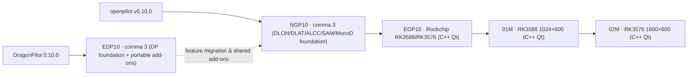

<div align="center">

<h1>EDP10 🐉</h1>
<p><b>The conservative DragonPilot 0.10.0 development line for original comma 3 (BYD Atto 3 & Chery/Omoda/iCaur/JAECOO).</b></p>

<h3><a href="#openpilot-vs-edp10">Features</a> · <a href="#-highlight-features">Highlights</a> · <a href="#-branches">Branches</a> · <a href="#-how-to-install">Install</a> · <a href="docs/SAFETY.md">Safety</a></h3>

[](LICENSE)
[](https://github.com/exo-elec/openpilot/tree/dev/EDP10)
[](https://github.com/exo-elec/openpilot/commits/dev/EDP10)

</div>

---

## Using EDP10 in a car

1. **Device:** original comma 3, with its wide/narrow road cameras. This branch does not target Exopilot Rockchip boards.
2. **Software:** `dev/EDP10`, built and configured for this project.
3. **Vehicle:** BYD Atto 3 and Chery / Omoda / iCaur / JAECOO targets; identification, harness and Panda safety support must match the build.
4. **Validation:** follow the [branch concept](exopilot/docs/BRANCH_CONCEPT.md) and [migration plan](exopilot/docs/MIGRATION_PLAN.md). Factory longitudinal/AEB is the project default; openpilot longitudinal is a separate trial.

EDP10 remains development-only. “Conservative” describes project scope, not a tested release or a safety certification.

## openpilot vs EDP10

**Base:** DragonPilot 0.10.0 (`549577a29d`) · **Reference:** openpilot v0.10.0 · **Reviewed:** 2026-11-28

✅ Implemented / inherited · ❌ Absent · ⏳ Deferred / incomplete



#### Core Features

| Feature | openpilot v0.10.0 | EDP10 | Reference / Relationship |
|---|---|---|---|
| Adaptive Cruise Control (ACC) | ✅ | ✅ | Upstream openpilot MPC; factory BYD longitudinal remains default |
| Experimental driving mode (EXP) | ✅ | ✅ | Openpilot longitudinal requires separate validation |
| Adaptive Experimental Mode (AEM) | ❌ | ✅ | DragonPilot `dp_lon_aem` (fixed `FirstOrderFilter` exact `rc` constants); distinct from NGP DLON |
| Adaptive Coasting Mode (ACM) | ❌ | ✅ | DragonPilot optional `dp_lon_acm` + downhill option |
| Camera Driver Monitoring (DM) | ✅ | ✅ | Upstream camera DM retained (NGP SAM `driveractivityd` is NGP10+ only) |
| Adaptive DLON / DLAT Foundation | ❌ | ❌ | Deliberately kept on `NGP10`+; EDP10 retains DragonPilot `ACM`/`AEM`/`ALKA` foundation |

#### Device & Hardware

| Feature | openpilot v0.10.0 | EDP10 | Reference / Relationship |
|---|---|---|---|
| Original comma 3 | ✅ | ✅ | Snapdragon 845 target |
| Vehicle integration | ✅ | ✅ | BYD Atto 3 (CarrotPilot-derived reference + ISO 11270 VM) & Chery/Omoda/iCaur/JAECOO ports with Panda safety (`byd.h`, `chery.h`) |
| Exopilot HAL / RK3588 / RK3576 | ❌ | ❌ | EOP-only hardware; not imported into EDP10 |
| Native Qt UI / offroad settings | ✅ | ✅ | `dp_panel.cc` toggles + offline OSM `MapdAreaRows` picker/downloader |
| Driving model selector | ❌ | ✅ | DragonPilot model selector |
| Dashy dashboard / beep / logging delay / shutdown | ❌ | ✅ | DragonPilot optional device utilities |
| Modern NGP Chestnut runner / USB eGPU | ❌ | ❌ | NGP10+ only |

#### Gas / Brake & Speed Add-Ons

| Feature | openpilot v0.10.0 | EDP10 | Reference / Relationship |
|---|---|---|---|
| Bumpy Road Speed Controller (BRSC) | ❌ | ✅ | Shared `exopilot/selfdrive/controls/lib/brsc.py` (`ngp_lon_brsc`, comma 3 `-v[0]` vertical axis, finite guards) |
| Vision Turn Speed Controller (VTSC) | ❌ | ✅ | Shared `vtsc.py` (`VTSCEnabled`, opt-in OFF); Sunnypilot SCC-V state machine + FrogPilot comfort buckets |
| Map Turn Speed Controller (MTSC) | ❌ | ✅ | Shared `mtsc.py` + `curve_speed.py` (`MTSCEnabled`, opt-in OFF); proactive 150–500 m OSM curve slowdown, 3.0 s hold |
| Map Speed Limit Controller (MSLC) | ❌ | ✅ | Shared `mslc.py` (`MSLCEnabled`, opt-in OFF); FrogPilot bucket offsets/confirmation via offline `mapd` v2.4.0 |
| Offline OSM Map Daemon (`mapd`) | ❌ | ✅ | Vendored `third_party/mapd/` v2.4.0 (`pfeiferj/openpilot-mapd`, `MapdEnabled`, opt-in OFF) + `MapdAreaRows` UI |
| Low-speed Traffic Jam Assist (TJA) | ❌ | ✅ | `selfdrive/controls/lib/dp_tja.py` + `exopilot/common/speed_zones.py` |
| Lane-change Adjacent Lead Handoff | ❌ | ✅ | Shared `lc_lead_handoff.py` (`LCAdjacentLeadHandoff`, opt-in OFF); tracks target-lane lead during `laneChangeStarting` |
| Lead Departure Alert | ❌ | ✅ | Shared `lead_departure.py` (`LeadDepartAlert`, opt-in OFF); alerts when stopped lead pulls away |
| Navigation / Traffic-Light / Distraction Speed (NSLC / TLSC / DDSC / RCSC) | ❌ | ❌ | `NGP10`+ only (requires navigation/perception/SAM pipeline) |
| Radar AEB / RCD / SQSC | ❌ | ❌ | Preserve stock BYD AEB; EOP perception stack stays on `EOP10`+ |
| External radar option | ✅ | ✅ | DragonPilot `dp_lon_ext_radar`; not Exopilot forward UART Radar3D |

#### Steering & Lane Changes

| Feature | openpilot v0.10.0 | EDP10 | Reference / Relationship |
|---|---|---|---|
| Lane Centering (LKAS) | ✅ | ✅ | Supported interface and validated Panda safety model required |
| Always-on Lane Centering (ALCC) | ❌ | ✅ | DragonPilot `dp_lat_alka` (driver label ALCC) |
| Lane Change Assist (LCA) | ✅ | ✅ | Minimum speed and optional delay via `dp_lat_lca_*` |
| Road-edge lane-change guard (RED) | ✅ | ✅ | DragonPilot `dp_lat_road_edge_detection` blocks unsafe lane changes |
| Lane-Change Adjacent Gap & Width Guards | ❌ | ✅ | Shared `lane_gap.py` (`LCAGapEvalEnabled`, `LCALaneWidthEnabled`, opt-in OFF); blocks narrow (<2.5 m) or unsafe TTC gap |
| Blinker Pause Lateral & Smooth Resume Ramp | ❌ | ✅ | Shared `blinker_pause.py` (`BlinkerPauseLateralSpeed`, Sunnypilot style) + `steering_policy.py` (`SteeringResumeRamp`) |
| Car Adaptive Tuning (CAT) | ❌ | ✅ | Shared `cat.py` (`CATEnabled`, opt-in OFF); smooths/bounds `liveParameters` steerRatio & stiffnessFactor |
| Smart Offset Control / LatNudge / LonNudge | ❌ | ❌ | `NGP10`+ / `EOP10`+ perception pipeline |

#### Radar, UI & Voice

| Feature | openpilot v0.10.0 | EDP10 | Reference / Relationship |
|---|---|---|---|
| OEM blind-spot flags | ✅ | ✅ | Actual BSM flags; no invented surround objects |
| Canonical Radar2D / Radar3D / Radar4D EOP pipeline | ❌ | ❌ | `EOP10`+ only |
| MonoD / GridD / PathD / DPP | ❌ | ❌ | `NGP10`+ / `EOP10`+ only |
| 01M / 02M C++ Qt theme & wide layout | ❌ | ❌ | EDP10 retains DragonPilot native Qt |
| Google cloudd voice / CPU wake / animated voice card | ❌ | ❌ | `EOP10`+ only |
| Portable TripD | ❌ | ⏳ | Optional later port |

## 🌟 Highlight Features

| | Feature | Origin / behavior |
|---|---|---|
| 🐉 | AEM / ACM / ALCC / LCA / RED | DragonPilot 0.10.0 foundation (with exact `FirstOrderFilter(rc)` AEM fix) |
| 🛞 | VTSC / MTSC / MSLC / Offline `mapd` / BRSC / TJA | Shared ExoPilot pure policies (Sunnypilot SCC-V, FrogPilot comfort/SLC, `pfeiferj/openpilot-mapd` v2.4.0, vertical-IMU BRSC) |
| 🛡️ | LC Gap & Width Guards / LC Lead Handoff / BlinkerPause / Resume Ramp / CAT / Lead Departure | Opt-in default-OFF safety & comfort add-ons ported byte-identical from `dev/NGP10` |
| 🚘 | BYD Atto 3 & Chery/Omoda/iCaur/JAECOO | Active lateral Panda safety (`byd.h`, `chery.h`) with 8-pt speed-zone backstop; factory longitudinal/AEB default |

### 🧪 Host Simulation & Verification (2026-11-28)

Verified on Linux host PC (Ryzen 7 7840HS + NVIDIA RTX 4050 Laptop GPU + PoCL 5.0 OpenCL):
- **Unit, controls, longitudinal maneuvers & messaging**: `489 passed` (+ `58` subtests), `ruff check exopilot/` clean, `scons` C++ Qt UI (`selfdrive/ui/ui`) & `cereal` build clean.
- **BYD & Chery Panda `libsafety` C hooks**: `92 passed, 4 skipped` (`test_byd.py` + `test_chery.py`).
- **MetaDrive 3D closed-loop behavioral suite** (`exopilot/tests/test_edp10_metadrive_loop.py`, WSLg RTX 4050 EGL + PoCL OpenCL NV12 + VisionIPC):
  - **VTSC**: R=60 m 90° curve slowdown, 100% in-lane tracking, straight-exit recovery, 23 GPU→OpenCL NV12→VisionIPC frames.
  - **MTSC**: proactive deceleration ahead of 260 m OSM curve + deterministic 3.0 s timeout expiry & recovery.
  - **MSLC**: real physics speed cap at 36 km/h (10 m/s) + acceleration on speed-limit raise to 65 km/h.
  - **BRSC**: longitudinal `-v[2]` axis rejection, vertical `-v[0]` washboard slowdown, smooth-road recovery & immediate IMU-dropout hold clear.
  - **Lateral/Safety**: LC adjacent-lead handoff deceleration, `DesireHelper` narrow-lane & gap guards against real 3.6 m MetaDrive lanes, AEM EMA tracking, `BlinkerPause` + `SteeringResumeRamp`, bounded `CAT`, and standstill `LeadDepartureNotice`.

| Branch | Parent | Main difference |
|---|---|---|
| EDP10 | DragonPilot 0.10.0 (`549577a29d`) | Comma 3 / BYD & Chery ports (standalone DP history; feature-migration origin for NGP10) |
| NGP10 | openpilot v0.10.0 | Portable ExoPilot controls / SAM / BigModel / PLP v5 / offline mapd (C++ Qt) |
| EOP10 | NGP10 | Extended ExoPilot Rockchip HAL / sensors / perception / cloud (C++ Qt) |
| 01M | EOP10 | ExoPilot 01M RK3588 1024×600 native C++ Qt UI profile |
| 02M | 01M | ExoPilot 02M RK3576 1600×600 wide native C++ Qt UI profile |

[EDP branch concept](exopilot/docs/BRANCH_CONCEPT.md) · [Migration plan](exopilot/docs/MIGRATION_PLAN.md) · [Other branches: full comparison](https://github.com/exo-elec/openpilot/blob/dev/NGP10/exopilot/docs/BRANCH_FEATURE_COMPARISON.md)

## 🔧 Branches

| Branch | Hardware / purpose | Status |
|---|---|---|
| `dev/EDP10` **(this branch)** | Original comma 3 / BYD Atto 3 & Chery, DragonPilot base | Development (standalone DP history) |
| `dev/NGP10` | Comma 3 portable ExoPilot baseline (C++ Qt) | Development |
| `dev/EOP10` | ExoPilot Rockchip platform base (C++ Qt) | Development |
| `dev/01M` | ExoPilot 01M RK3588 1024×600 C++ Qt UI | Development |
| `dev/02M` | ExoPilot 02M RK3576 1600×600 C++ Qt UI | Development |

## 🧰 How to Install

No EDP installer URL is advertised. All vendor trees (including `opendbc_repo` and `panda`) are vendored inline on this branch (no `.gitmodules`):

```bash
git clone --branch dev/EDP10 https://github.com/exo-elec/openpilot.git
```

Complete the [migration/setup requirements](exopilot/docs/MIGRATION_PLAN.md) before building or running. Cloning source is not device installation or vehicle validation. The upstream installer examples in the reference section below install upstream software, not EDP10.

## 🐞 Bug Reports / Feature Requests

Use [GitHub Issues](https://github.com/exo-elec/openpilot/issues). Include branch, device, vehicle, versions, reproduction steps and relevant logs.

## 📋 Credits

- [commaai/openpilot](https://github.com/commaai/openpilot): baseline software (v0.10.0) and MIT notices.
- [dragonpilot / Rick Lan](https://github.com/dragonpilot/dragonpilot): inherited DragonPilot 0.10.0 foundation (`ACM`, `AEM`, `ALKA`/`ALCC`, `LCA`, `RED`, `dp_panel`).
- [sunnypilot](https://github.com/sunnypilot/sunnypilot): reference design for vision curve control (`SCC-V` → VTSC) and low-speed blinker pause (`BlinkerPause`).
- [FrogPilot](https://github.com/FrogAi/FrogPilot): reference design for curve comfort buckets, speed-limit bucket offsets/confirmation (`MSLC`), and README feature-table layout.
- [CarrotPilot](https://github.com/bulletmark/carrotpilot): community BYD Atto 3 CAN/HUD protocol reference cross-checked against hardware captures.
- [pfeiferj/openpilot-mapd](https://github.com/pfeiferj/openpilot-mapd): vendored offline OSM `mapd` v2.4.0 binary & download menu.
- ExoPilot: shared pure control policies (`exopilot/selfdrive/controls/lib/`) and MetaDrive closed-loop verification harness.

## ⚖️ Safety & Validation

Inherited source and project plans do not establish a tested release. Vehicle identification, camera/process configuration, Panda safety and longitudinal trial gates remain deployment requirements. EDP10 does not inherit NGP's new SAM producer or EOP's radar emergency-braking implementation. Read [SAFETY.md](docs/SAFETY.md) and the branch-specific migration notes. Original license and upstream reference notices follow.

---

<a id="project-details"></a>

📖 Details
------

<details>
<summary>Upstream reference documentation and notices</summary>

<div align="center" style="text-align: center;">

<h1>openpilot</h1>

<p>
  <b>openpilot is an operating system for robotics.</b>
  <br>
  Currently, it upgrades the driver assistance system in 300+ supported cars.
</p>

<h3>
  <a href="https://docs.comma.ai">Docs</a>
  <span> · </span>
  <a href="https://docs.comma.ai/contributing/roadmap/">Roadmap</a>
  <span> · </span>
  <a href="https://github.com/commaai/openpilot/blob/master/docs/CONTRIBUTING.md">Contribute</a>
  <span> · </span>
  <a href="https://discord.comma.ai">Community</a>
  <span> · </span>
  <a href="https://comma.ai/shop">Try it on a comma 3X</a>
</h3>

Quick start: `bash <(curl -fsSL openpilot.comma.ai)`

[](https://github.com/commaai/openpilot/actions/workflows/selfdrive_tests.yaml)
[](LICENSE)
[](https://x.com/comma_ai)
[](https://discord.comma.ai)

</div>

<table>
  <tr>
    <td><a href="https://youtu.be/NmBfgOanCyk" title="Video By Greer Viau"></a></td>
    <td><a href="https://youtu.be/VHKyqZ7t8Gw" title="Video By Logan LeGrand"></a></td>
    <td><a href="https://youtu.be/SUIZYzxtMQs" title="A drive to Taco Bell"></a></td>
  </tr>
</table>


Using openpilot in a car
------

To use openpilot in a car, you need four things:
1. **Supported Device:** a comma 3/3X, available at [comma.ai/shop](https://comma.ai/shop/comma-3x).
2. **Software:** The setup procedure for the comma 3/3X allows users to enter a URL for custom software. Use the URL `openpilot.comma.ai` to install the release version.
3. **Supported Car:** Ensure that you have one of [the 275+ supported cars](docs/CARS.md).
4. **Car Harness:** You will also need a [car harness](https://comma.ai/shop/car-harness) to connect your comma 3/3X to your car.

We have detailed instructions for [how to install the harness and device in a car](https://comma.ai/setup). Note that it's possible to run openpilot on [other hardware](https://blog.comma.ai/self-driving-car-for-free/), although it's not plug-and-play.

### Branches
| branch           | URL                                    | description                                                                         |
|------------------|----------------------------------------|-------------------------------------------------------------------------------------|
| `release3`         | openpilot.comma.ai                      | This is openpilot's release branch.                                                 |
| `release3-staging` | openpilot-test.comma.ai                | This is the staging branch for releases. Use it to get new releases slightly early. |
| `nightly`          | openpilot-nightly.comma.ai             | This is the bleeding edge development branch. Do not expect this to be stable.      |
| `nightly-dev`      | installer.comma.ai/commaai/nightly-dev | Same as nightly, but includes experimental development features for some cars.      |
| `secretgoodopenpilot` | installer.comma.ai/commaai/secretgoodopenpilot | This is a preview branch from the autonomy team where new driving models get merged earlier than master. |

To start developing openpilot
------

openpilot is developed by [comma](https://comma.ai/) and by users like you. We welcome both pull requests and issues on [GitHub](http://github.com/commaai/openpilot).

* Join the [community Discord](https://discord.comma.ai)
* Check out [the contributing docs](docs/CONTRIBUTING.md)
* Check out the [openpilot tools](tools/)
* Code documentation lives at https://docs.comma.ai
* Information about running openpilot lives on the [community wiki](https://github.com/commaai/openpilot/wiki)

Want to get paid to work on openpilot? [comma is hiring](https://comma.ai/jobs#open-positions) and offers lots of [bounties](https://comma.ai/bounties) for external contributors.

Safety and Testing
----

* openpilot observes [ISO26262](https://en.wikipedia.org/wiki/ISO_26262) guidelines, see [SAFETY.md](docs/SAFETY.md) for more details.
* openpilot has software-in-the-loop [tests](https://github.com/commaai/openpilot/blob/v0.10.0/.github/workflows/selfdrive_tests.yaml) that run on every commit.
* The code enforcing the safety model lives in panda and is written in C, see [code rigor](https://github.com/commaai/panda#code-rigor) for more details.
* panda has software-in-the-loop [safety tests](https://github.com/commaai/panda/tree/master/tests/safety).
* Internally, we have a hardware-in-the-loop Jenkins test suite that builds and unit tests the various processes.
* panda has additional hardware-in-the-loop [tests](https://github.com/commaai/panda/blob/master/Jenkinsfile).
* We run the latest openpilot in a testing closet containing 10 comma devices continuously replaying routes.

<details>
<summary>MIT Licensed</summary>

openpilot is released under the MIT license. Some parts of the software are released under other licenses as specified.

Any user of this software shall indemnify and hold harmless Comma.ai, Inc. and its directors, officers, employees, agents, stockholders, affiliates, subcontractors and customers from and against all allegations, claims, actions, suits, demands, damages, liabilities, obligations, losses, settlements, judgments, costs and expenses (including without limitation attorneys’ fees and costs) which arise out of, relate to or result from any use of this software by user.

**THIS IS ALPHA QUALITY SOFTWARE FOR RESEARCH PURPOSES ONLY. THIS IS NOT A PRODUCT.
YOU ARE RESPONSIBLE FOR COMPLYING WITH LOCAL LAWS AND REGULATIONS.
NO WARRANTY EXPRESSED OR IMPLIED.**
</details>

<details>
<summary>User Data and comma Account</summary>

By default, openpilot uploads the driving data to our servers. You can also access your data through [comma connect](https://connect.comma.ai/). We use your data to train better models and improve openpilot for everyone.

openpilot is open source software: the user is free to disable data collection if they wish to do so.

openpilot logs the road-facing cameras, CAN, GPS, IMU, magnetometer, thermal sensors, crashes, and operating system logs.
The driver-facing camera and microphone are only logged if you explicitly opt-in in settings.

By using openpilot, you agree to [our Privacy Policy](https://comma.ai/privacy). You understand that use of this software or its related services will generate certain types of user data, which may be logged and stored at the sole discretion of comma. By accepting this agreement, you grant an irrevocable, perpetual, worldwide right to comma for the use of this data.
</details>

</details>
