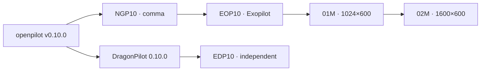

<div align="center">

<h1>EDP10 🐉</h1>
<p><b>The independent DragonPilot 0.10.0 development line for original comma 3 and BYD Atto 3.</b></p>

<h3><a href="#openpilot-vs-edp10">Features</a> · <a href="#-highlight-features">Highlights</a> · <a href="#-branches">Branches</a> · <a href="#-how-to-install">Install</a> · <a href="docs/SAFETY.md">Safety</a></h3>

[](LICENSE)
[](https://github.com/exo-elec/openpilot/tree/dev/EDP10)
[](https://github.com/exo-elec/openpilot/commits/dev/EDP10)

</div>

---

## Using EDP10 in a car

1. **Device:** original comma 3, with its wide/narrow road cameras. This branch does not target Exopilot Rockchip boards.
2. **Software:** `dev/EDP10`, built and configured for this project.
3. **Vehicle:** the BYD Atto 3 development target; identification, harness and Panda safety support must match the build.
4. **Validation:** follow the [branch concept](nagaspilot/docs/BRANCH_CONCEPT.md) and [migration plan](nagaspilot/docs/MIGRATION_PLAN.md). Factory longitudinal/AEB is the project default; openpilot longitudinal is a separate trial.

EDP10 remains development-only. “Conservative” describes project scope, not a tested release or a safety certification.

## openpilot vs EDP10

**Base:** DragonPilot 0.10.0 · **Reference:** openpilot v0.10.0 · **Reviewed:** 2026-10-09

✅ Implemented / inherited · ❌ Absent · ⏳ Deferred / incomplete



#### Core Features

| Feature | openpilot v0.10.0 | EDP10 | Relationship / limitations |
|---|---|---|---|
| Adaptive Cruise Control (ACC) | ✅ | ✅ | Factory BYD longitudinal remains the project default |
| Experimental driving mode (EXP) | ✅ | ✅ | Openpilot longitudinal requires separate validation |
| Adaptive Experimental Mode (AEM) | ❌ | ✅ | `dp_lon_aem`; ACC/blended arbitration, not NGP DLON |
| Adaptive Coasting Mode (ACM) | ❌ | ✅ | Optional `dp_lon_acm`, downhill option; not validated BYD braking behavior |
| Camera Driver Monitoring (DM) | ✅ | ✅ | Legacy configuration/disable behavior requires deployment review |
| Shared NGP Steering Activity Monitoring (SAM) | ❌ | ❌ | Current NGP driveractivityd replacement is not ported here |
| DLON / DLAT fork profiles | ❌ | ❌ | Deferred/rejected by EDP port plan; AEM remains distinct |

#### Device & Hardware

| Feature | openpilot v0.10.0 | EDP10 | Relationship / limitations |
|---|---|---|---|
| Original comma 3 | ✅ | ✅ | Snapdragon 845 target |
| Vehicle integration | ✅ | ✅ | Separate BYD port and Panda safety work |
| Exopilot HAL / RK3588 / RK3576 | ❌ | ❌ | EOP-only hardware; not imported into EDP |
| Native Qt UI / offroad settings | ✅ | ✅ | `dp_*` settings and device-specific controls |
| Driving model selector | ❌ | ✅ | Model provisioning and compatibility required |
| Dashy dashboard / beep / logging delay / shutdown | ❌ | ✅ | Optional/configuration-dependent, not a blanket enabled claim |
| Modern NGP Chestnut runner / USB eGPU | ❌ | ❌ | Latest NGP integration is not carried into EDP |

#### Gas / Brake

| Feature | openpilot v0.10.0 | EDP10 | Relationship / limitations |
|---|---|---|---|
| Bumpy Road Speed Controller (BRSC) | ❌ | ✅ | `ngp_lon_brsc` with EDP DPFlags/plannerd integration |
| Vision Turn Speed Controller (VTSC) | ❌ | ⏳ | Previous “ported” documentation was corrected; remains deferred |
| Dynamic TJA / lane-change lead handoff | ❌ | ⏳ | Not equivalent to NGP/EOP additions |
| Map / navigation / traffic-light controllers (MTSC / MSLC / NSLC / TLSC) | ❌ | ❌ | No current NGP/EOP feature carryover claim |
| Radar AEB / RCD / SQSC | ❌ | ❌ | Preserve stock BYD AEB; no EOP perception intervention port |
| External radar option | ✅ | ✅ | `dp_lon_ext_radar`; not Exopilot forward UART Radar3D |

#### Steering & Lane Changes

| Feature | openpilot v0.10.0 | EDP10 | Relationship / limitations |
|---|---|---|---|
| Lane Centering (LKAS) | ✅ | ✅ | Supported interface and validated safety model required |
| Always-on Lane Centering (ALCC) | ❌ | ✅ | Driver label ALCC; internal `dp_lat_alka` compatibility retained |
| Lane Change Assist (LCA) | ✅ | ✅ | Minimum speed and optional delay via `dp_lat_lca_*` |
| Road-edge lane-change guard (RED) | ✅ | ✅ | Blocks lane changes; not EOP curvature nudge/side-camera classification |
| Smart Offset Control / CAT / LatNudge / LonNudge | ❌ | ❌ | EOP implementations not adopted by the conservative port |

#### Radar, UI & Voice

| Feature | openpilot v0.10.0 | EDP10 | Relationship / limitations |
|---|---|---|---|
| OEM blind-spot flags | ✅ | ✅ | Actual BSM flags; no invented surround objects |
| Canonical Radar2D / Radar3D / Radar4D EOP pipeline | ❌ | ❌ | Distinct from DragonPilot external radar support |
| MonoD / GridD / PathD / DPP | ❌ | ❌ | Current shared NGP/EOP perception pipeline not ported |
| PyQt5 Nagasware layout / floating OSM widgets | ❌ | ❌ | EDP retains native Qt, not 01M/02M presentation |
| Google cloudd voice / CPU wake / animated voice card | ❌ | ❌ | EOP implementation not carried here |
| Portable TripD | ❌ | ⏳ | Listed as an optional later port, not implemented support |

## 🌟 Highlight Features

| | Feature | Origin / behavior |
|---|---|---|
| 🐉 | AEM / ACM / ALCC / LCA | Carried from DragonPilot |
| 🛞 | BRSC | Portable NGP policy + EDP planner glue |
| 🚘 | BYD Atto 3 target | Factory longitudinal/AEB by default |
| 🧱 | Independent baseline | No Exopilot HAL or 01M/02M UI |

| Branch | Parent | Main difference |
|---|---|---|
| EDP10 | DragonPilot 0.10.0 | Independent comma 3 / BYD line |
| NGP10 | openpilot v0.10.0 | Portable controls / SAM / camera pipeline |
| EOP10 | NGP10 | Extended Exopilot vehicle / sensors / cloud |
| 01M | EOP10 | Shared 1024×600 PyQt5 profile |
| 02M | 01M | Shared 1600×600 profile + floating panels |

[EDP branch concept](nagaspilot/docs/BRANCH_CONCEPT.md) · [Migration plan](nagaspilot/docs/MIGRATION_PLAN.md) · [Other branches: full comparison](https://github.com/exo-elec/openpilot/blob/dev/NGP10/nagaspilot/docs/BRANCH_FEATURE_COMPARISON.md)

## 🔧 Branches

| Branch | Hardware / purpose | Status |
|---|---|---|
| `dev/EDP10` **(this branch)** | Original comma 3 / BYD Atto 3, DragonPilot base | Independent development line |
| `dev/NGP10` | Comma portable feature baseline | Development |
| `dev/EOP10` | Exopilot platform base | Development |
| `dev/01M` | 1024×600 PyQt5 display | Development |
| `dev/02M` | 1600×600 PyQt5 display | Development |

## 🧰 How to Install

No EDP installer URL is advertised. Download this branch and its pinned submodules:

```bash
git clone --recurse-submodules --branch dev/EDP10 https://github.com/exo-elec/openpilot.git
```

Complete the [migration/setup requirements](nagaspilot/docs/MIGRATION_PLAN.md) before building or running. Cloning source is not device installation or vehicle validation. The upstream installer examples in the reference section below install upstream software, not EDP10.

## 🐞 Bug Reports / Feature Requests

Use [GitHub Issues](https://github.com/exo-elec/openpilot/issues). Include branch, device, vehicle, versions, reproduction steps and relevant logs.

## 📋 Credits

- [comma.ai openpilot](https://github.com/commaai/openpilot): baseline software and MIT notices.
- [DragonPilot / Rick Lan](https://github.com/dragonpilot/dragonpilot): inherited DragonPilot implementation and history.
- NagasPilot: selected portable policy ports, including BRSC.
- README presentation inspired by [FrogPilot](https://github.com/FrogAi/FrogPilot/blob/FrogPilot/README.md); feature claims remain specific to this branch.

## ⚖️ Safety & Validation

Inherited source and project plans do not establish a tested release. Vehicle identification, camera/process configuration, Panda safety and longitudinal trial gates remain deployment requirements. EDP10 does not inherit NGP's new SAM producer or EOP's radar emergency-braking implementation. Read [SAFETY.md](docs/SAFETY.md) and the branch-specific migration notes. Original license and upstream reference notices follow.

---

<a id="project-details"></a>

📖 Details
------

<details>
<summary>Upstream reference documentation and notices</summary>

<div align="center" style="text-align: center;">

<h1>openpilot</h1>

<p>
  <b>openpilot is an operating system for robotics.</b>
  <br>
  Currently, it upgrades the driver assistance system in 300+ supported cars.
</p>

<h3>
  <a href="https://docs.comma.ai">Docs</a>
  <span> · </span>
  <a href="https://docs.comma.ai/contributing/roadmap/">Roadmap</a>
  <span> · </span>
  <a href="https://github.com/commaai/openpilot/blob/master/docs/CONTRIBUTING.md">Contribute</a>
  <span> · </span>
  <a href="https://discord.comma.ai">Community</a>
  <span> · </span>
  <a href="https://comma.ai/shop">Try it on a comma 3X</a>
</h3>

Quick start: `bash <(curl -fsSL openpilot.comma.ai)`

[](https://github.com/commaai/openpilot/actions/workflows/selfdrive_tests.yaml)
[](LICENSE)
[](https://x.com/comma_ai)
[](https://discord.comma.ai)

</div>

<table>
  <tr>
    <td><a href="https://youtu.be/NmBfgOanCyk" title="Video By Greer Viau"></a></td>
    <td><a href="https://youtu.be/VHKyqZ7t8Gw" title="Video By Logan LeGrand"></a></td>
    <td><a href="https://youtu.be/SUIZYzxtMQs" title="A drive to Taco Bell"></a></td>
  </tr>
</table>


Using openpilot in a car
------

To use openpilot in a car, you need four things:
1. **Supported Device:** a comma 3/3X, available at [comma.ai/shop](https://comma.ai/shop/comma-3x).
2. **Software:** The setup procedure for the comma 3/3X allows users to enter a URL for custom software. Use the URL `openpilot.comma.ai` to install the release version.
3. **Supported Car:** Ensure that you have one of [the 275+ supported cars](docs/CARS.md).
4. **Car Harness:** You will also need a [car harness](https://comma.ai/shop/car-harness) to connect your comma 3/3X to your car.

We have detailed instructions for [how to install the harness and device in a car](https://comma.ai/setup). Note that it's possible to run openpilot on [other hardware](https://blog.comma.ai/self-driving-car-for-free/), although it's not plug-and-play.

### Branches
| branch           | URL                                    | description                                                                         |
|------------------|----------------------------------------|-------------------------------------------------------------------------------------|
| `release3`         | openpilot.comma.ai                      | This is openpilot's release branch.                                                 |
| `release3-staging` | openpilot-test.comma.ai                | This is the staging branch for releases. Use it to get new releases slightly early. |
| `nightly`          | openpilot-nightly.comma.ai             | This is the bleeding edge development branch. Do not expect this to be stable.      |
| `nightly-dev`      | installer.comma.ai/commaai/nightly-dev | Same as nightly, but includes experimental development features for some cars.      |
| `secretgoodopenpilot` | installer.comma.ai/commaai/secretgoodopenpilot | This is a preview branch from the autonomy team where new driving models get merged earlier than master. |

To start developing openpilot
------

openpilot is developed by [comma](https://comma.ai/) and by users like you. We welcome both pull requests and issues on [GitHub](http://github.com/commaai/openpilot).

* Join the [community Discord](https://discord.comma.ai)
* Check out [the contributing docs](docs/CONTRIBUTING.md)
* Check out the [openpilot tools](tools/)
* Code documentation lives at https://docs.comma.ai
* Information about running openpilot lives on the [community wiki](https://github.com/commaai/openpilot/wiki)

Want to get paid to work on openpilot? [comma is hiring](https://comma.ai/jobs#open-positions) and offers lots of [bounties](https://comma.ai/bounties) for external contributors.

Safety and Testing
----

* openpilot observes [ISO26262](https://en.wikipedia.org/wiki/ISO_26262) guidelines, see [SAFETY.md](docs/SAFETY.md) for more details.
* openpilot has software-in-the-loop [tests](https://github.com/commaai/openpilot/blob/v0.10.0/.github/workflows/selfdrive_tests.yaml) that run on every commit.
* The code enforcing the safety model lives in panda and is written in C, see [code rigor](https://github.com/commaai/panda#code-rigor) for more details.
* panda has software-in-the-loop [safety tests](https://github.com/commaai/panda/tree/master/tests/safety).
* Internally, we have a hardware-in-the-loop Jenkins test suite that builds and unit tests the various processes.
* panda has additional hardware-in-the-loop [tests](https://github.com/commaai/panda/blob/master/Jenkinsfile).
* We run the latest openpilot in a testing closet containing 10 comma devices continuously replaying routes.

<details>
<summary>MIT Licensed</summary>

openpilot is released under the MIT license. Some parts of the software are released under other licenses as specified.

Any user of this software shall indemnify and hold harmless Comma.ai, Inc. and its directors, officers, employees, agents, stockholders, affiliates, subcontractors and customers from and against all allegations, claims, actions, suits, demands, damages, liabilities, obligations, losses, settlements, judgments, costs and expenses (including without limitation attorneys’ fees and costs) which arise out of, relate to or result from any use of this software by user.

**THIS IS ALPHA QUALITY SOFTWARE FOR RESEARCH PURPOSES ONLY. THIS IS NOT A PRODUCT.
YOU ARE RESPONSIBLE FOR COMPLYING WITH LOCAL LAWS AND REGULATIONS.
NO WARRANTY EXPRESSED OR IMPLIED.**
</details>

<details>
<summary>User Data and comma Account</summary>

By default, openpilot uploads the driving data to our servers. You can also access your data through [comma connect](https://connect.comma.ai/). We use your data to train better models and improve openpilot for everyone.

openpilot is open source software: the user is free to disable data collection if they wish to do so.

openpilot logs the road-facing cameras, CAN, GPS, IMU, magnetometer, thermal sensors, crashes, and operating system logs.
The driver-facing camera and microphone are only logged if you explicitly opt-in in settings.

By using openpilot, you agree to [our Privacy Policy](https://comma.ai/privacy). You understand that use of this software or its related services will generate certain types of user data, which may be logged and stored at the sole discretion of comma. By accepting this agreement, you grant an irrevocable, perpetual, worldwide right to comma for the use of this data.
</details>

</details>
