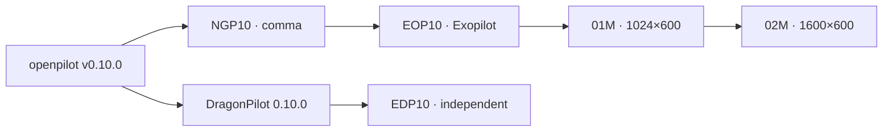

<div align="center" style="text-align: center;">

<h1>NagasPilot</h1>

<p>
  <b>A fork of openpilot v0.10.0 with smarter cruise control, steering and lane changes.</b>
</p>

<h3>
  <a href="#openpilot-vs-nagaspilot-vs-exopilot">Features</a>
  <span> · </span>
  <a href="#-branches">Branches</a>
  <span> · </span>
  <a href="#-how-to-install">Install</a>
  <span> · </span>
  <a href="docs/CARS.md">Cars</a>
  <span> · </span>
  <a href="docs/SAFETY.md">Safety</a>
  <span> · </span>
  <a href="https://github.com/exo-elec/openpilot/issues">Issues</a>
</h3>

[](LICENSE)
[](https://github.com/exo-elec/openpilot/tree/dev/NGP10)
[](https://github.com/exo-elec/openpilot/commits/dev/NGP10)
[](https://github.com/exo-elec/openpilot/issues)

</div>

------

Using NagasPilot in a car
------

To use **NagasPilot** in a car, you need four things:

1. **Device:** a **comma 3 / 3X**.
2. **Software:** this branch (`dev/NGP10`). See *How to install* below.
3. **Car:** a supported car. See [docs/CARS.md](docs/CARS.md).
4. **Harness:** the harness that matches your car's make and model, to connect the device to the car.

NagasPilot has not been tested on a real vehicle yet. Read *Safety and legal* before you drive.

------

**NagasPilot** is based on **openpilot v0.10.0** (the full release, not v0.10.1 or later) and runs on the **comma 3 / 3X**. It is in development and has not yet been tested on a real vehicle.

## openpilot vs NagasPilot vs ExoPilot

**Base:** openpilot v0.10.0 · **Reviewed:** 2026-10-09

✅ Implemented / inherited · ❌ Absent · 🧪 Experimental · ⏳ Incomplete



#### Core Features

| Feature | openpilot v0.10.0 | NGP10 | EOP10 | 01M | 02M |
|---|---|---|---|---|---|
| Adaptive Cruise Control (ACC) | ✅ | ✅ | ✅ | ✅ | ✅ |
| Experimental driving mode (EXP) | ✅ | ✅ | ✅ | ✅ | ✅ |
| Dynamic Longitudinal Profile (DLON) | ❌ | ✅ | ✅ | ✅ | ✅ |
| Dynamic Lateral Profile (DLAT) | ❌ | ✅ | ✅ | ✅ | ✅ |
| Always-on Lateral Control (ALCC) | ❌ | ✅ | ✅ | ✅ | ✅ |
| Steering Activity Monitoring (SAM) | ❌ | ✅ | ✅ | ✅ | ✅ |
| Camera Driver Monitoring (DM) | ✅ | ❌ | ❌ | ❌ | ❌ |
| Road perception / parallel planner (MonoD / GridD / PathD / DPP) | ❌ | 🧪 | 🧪 | 🧪 | 🧪 |

#### Device & Hardware

| Feature | openpilot v0.10.0 | NGP10 | EOP10 | 01M | 02M |
|---|---|---|---|---|---|
| Comma 3 / 3X target | ✅ | ✅ | ❌ | ❌ | ❌ |
| Exopilot Rockchip target | ❌ | ❌ | ✅ | ✅ | ✅ |
| OpenDBC vehicle interface | ✅ | ✅ | ❌ | ❌ | ❌ |
| BrownPanda / vehicled gateway | ❌ | ❌ | ✅ | ✅ | ✅ |
| External OpenDBC dependency | ✅ | ✅ | ❌ | ❌ | ❌ |
| Exopilot extra cameras / accelerators | ❌ | ❌ | ✅ | ✅ | ✅ |
| Tinygrad / Chestnut | ✅ | ✅ | ✅ | ✅ | ✅ |
| New larger trained driving weights | ❌ | ⏳ | ⏳ | ⏳ | ⏳ |

#### Gas / Brake

| Feature | openpilot v0.10.0 | NGP10 | EOP10 | 01M | 02M |
|---|---|---|---|---|---|
| Traffic-jam / acceleration shaping (TJA) | ✅ | ✅ | ✅ | ✅ | ✅ |
| Bumpy Road Speed Controller (BRSC) | ❌ | ✅ | ✅ | ✅ | ✅ |
| Vision Turn Speed Controller (VTSC) | ❌ | ✅ | ✅ | ✅ | ✅ |
| Adaptive gap / Eco, Normal, Sport / speed offsets | ✅ | ✅ | ✅ | ✅ | ✅ |
| Navigation Speed Limit Control (NSLC) | ❌ | ⏳ | ✅ | ✅ | ✅ |
| Map Turn / Speed Limit Control (MTSC / MSLC) | ❌ | 🧪 | ✅ | ✅ | ✅ |
| Traffic Light Speed Control (TLSC) | ❌ | 🧪 | ✅ | ✅ | ✅ |
| Road Condition / Surface Quality (RCD / SQSC) | ❌ | 🧪 | 🧪 | 🧪 | 🧪 |
| Driver-decay speed cap (DDSC) | ❌ | ✅ | ✅ | ✅ | ✅ |
| Radar emergency-braking request (RSS AEB) | ❌ | ❌ | 🧪 | ✅ | ✅ |

#### Steering & Lane Changes

| Feature | openpilot v0.10.0 | NGP10 | EOP10 | 01M | 02M |
|---|---|---|---|---|---|
| Lane Centering (LKAS) | ✅ | ✅ | ✅ | ✅ | ✅ |
| Lane Change Assist (LCA) | ✅ | ✅ | ✅ | ✅ | ✅ |
| Road Edge Detection / guard (RED) | ✅ | ✅ | ✅ | ✅ | ✅ |
| Smart Offset Control (SOC) | ❌ | ✅ | ✅ | ✅ | ✅ |
| Car Adaptive Tuning (CAT) | ✅ | ✅ | ✅ | ✅ | ✅ |
| Smooth resume / blinker pause | ✅ | ✅ | ✅ | ✅ | ✅ |
| Gap / lane-width checks / lead handoff | ✅ | ✅ | ✅ | ✅ | ✅ |

#### Radar & Awareness

| Feature | openpilot v0.10.0 | NGP10 | EOP10 | 01M | 02M |
|---|---|---|---|---|---|
| Planar BSD (Radar2D) | ✅ | ✅ | ✅ | ✅ | ✅ |
| Forward UART radar (Radar3D) | ❌ | ❌ | ✅ | ✅ | ✅ |
| BLE surround tracks (Radar4D) | ❌ | ❌ | ✅ | ✅ | ✅ |
| Wi-Fi point-cloud reception | ❌ | ❌ | ✅ | ✅ | ✅ |
| Wi-Fi clustered-object tracking | ❌ | ❌ | ⏳ | ⏳ | ⏳ |
| Synthetic BrownPanda car-radar targets | ❌ | ❌ | ❌ | ❌ | ❌ |
| OEM blind-spot flags | ✅ | ✅ | ✅ | ✅ | ✅ |

#### UI, Navigation & Voice

| Feature | openpilot v0.10.0 | NGP10 | EOP10 | 01M | 02M |
|---|---|---|---|---|---|
| Native Qt/C++ presentation | ✅ | ✅ | ✅ | ❌ | ❌ |
| Shared PyQt5 presentation | ❌ | ❌ | ❌ | ✅ | ✅ |
| Wide 1600×600 driving layout | ❌ | ❌ | ❌ | ❌ | ✅ |
| Shared Nagasware tone / icons / offroad pages | ❌ | ❌ | ❌ | ✅ | ✅ |
| Floating left/right panels + OSM map | ❌ | ❌ | ❌ | ❌ | ✅ |
| Cloud voice (Google STT / Gemini / TTS) | ❌ | ❌ | ✅ | ✅ | ✅ |
| Local CPU wake / VAD endpointing | ❌ | ❌ | ✅ | ✅ | ✅ |
| Custom “Hi EXO” phrase weights | ❌ | ❌ | ⏳ | ⏳ | ⏳ |
| Animated listening / thinking / speaking popup | ❌ | ❌ | ❌ | ✅ | ✅ |
| Full Siri interaction parity / barge-in / AEC | ❌ | ❌ | ⏳ | ⏳ | ⏳ |
| Trip statistics (TripD) | ✅ | ✅ | ✅ | ✅ | ✅ |
| Lead departure / green-light notice | ❌ | ✅ | ✅ | ✅ | ✅ |

## 🌟 Highlight Features

| | Feature | Behavior |
|---|---|---|
| 🧠 | DLON / DLAT | Cruise/model and lane-confidence arbitration |
| 👐 | SAM | Input → awareness → warnings → forced deceleration |
| 📡 | Radar | 2D planar BSD · 3D forward UART · 4D surround |
| 🎨 | Adaptive PyQt5 | Shared icons, offroad pages and voice card |
| 🎙️ | Cloud voice | CPU wake → VAD → Opus → Google → Opus playback |

| Display | Driving view | Floating panels | Voice card |
|---|---|---|---|
| 01M · 1024×600 | Full screen | ❌ | Centered · 440×220 |
| 02M · 1600×600 | Wide screen | ✅ Left / right / OSM | Same centered card |

| Feature origin | NGP10 | EOP10 | 01M → 02M |
|---|---|---|---|
| Portable controls / SAM | Added | Carried | Carried |
| RED / SOC / sensor integration | Basic | Extended | Carried |
| Exopilot vehicle / radar / cloud | ❌ | Added | Carried |
| UI / display layout | Native Qt | Native Qt | PyQt5 → wider panels |

**Development builds:** models, credentials, sensors and vehicle validation may still be required. [Full comparison, defaults and gaps](nagaspilot/docs/BRANCH_FEATURE_COMPARISON.md).

---

🔧 Branches
------

| Branch | Install | Description | Recommended&nbsp;For |
|---|---|---|---|
| `dev/EOP10` | `git clone --recurse-submodules -b dev/EOP10` | The shared ExoPilot base. Every ExoPilot device gets these features. | ExoPilot&nbsp;Developers |
| `dev/01M` | `git clone --recurse-submodules -b dev/01M` | Shared EOP features with a 1024×600 full-screen PyQt5 display. | ExoPilot&nbsp;01M&nbsp;owners |
| `dev/02M` | `git clone --recurse-submodules -b dev/02M` | Shared EOP features with a 1600×600 PyQt5 display and floating side panels. | ExoPilot&nbsp;02M&nbsp;owners |
| `dev/NGP10`&nbsp;(this&nbsp;branch) | `git clone --recurse-submodules -b dev/NGP10` | NagasPilot: the smarter cruise, steering and lane-change features for the comma 3 / 3X. | comma&nbsp;3&nbsp;/&nbsp;3X&nbsp;owners |

Every branch is in development and has not been tested on a real vehicle. **Do not** treat any of them as a release.

🧰 How to Install
------

There is no installer URL yet. Clone this branch onto the device:

```
git clone --recurse-submodules -b dev/NGP10 https://github.com/exo-elec/openpilot.git
```

**DO NOT** drive with a build you have not read the notes for. Every `dev/` branch changes often and can break.

🐞 Bug Reports / Feature Requests
------

If you run into bugs, issues, or have ideas for new features, please open an issue on **[GitHub](https://github.com/exo-elec/openpilot/issues)**.

Please include as much detail as possible: which branch and device you use, what you did and what happened. Photos, videos, log files, or anything that can help explain the issue or idea are very helpful!

📋 Credits
------

* README presentation inspired by [FrogPilot](https://github.com/FrogAi/FrogPilot/blob/FrogPilot/README.md); project behavior and support claims are documented independently.
* [commaai/openpilot](https://github.com/commaai/openpilot): openpilot v0.10.0 (MIT)

Star History
------

[](https://www.star-history.com/#exo-elec/openpilot&Date)

------

⚖️ Safety and legal
------

- **NagasPilot** is a modified version of **openpilot v0.10.0** by comma.ai, used under the MIT license (see [LICENSE](LICENSE)). It is not made, endorsed or supported by comma.ai.
- Camera-based driver monitoring is removed from this software; SAM does not use a driver camera. Driver activity monitoring only warns and slows the car when you stop touching the wheel, brake or gas; it never switches off by itself. Keep watching the road.
- Baseline safety concepts are inherited, but monitoring and optional control policies are modified. See [docs/SAFETY.md](docs/SAFETY.md); this fork has no vehicle safety validation.
- New features have **not** been validated on a real vehicle. Always stay attentive and ready to take over.


**MIT licensed.** openpilot is released under the MIT license. Some parts of the software are released under other licenses as specified.

Any user of this software shall indemnify and hold harmless Comma.ai, Inc. and its directors, officers, employees, agents, stockholders, affiliates, subcontractors and customers from and against all allegations, claims, actions, suits, demands, damages, liabilities, obligations, losses, settlements, judgments, costs and expenses (including without limitation attorneys’ fees and costs) which arise out of, relate to or result from any use of this software by user.

**THIS IS ALPHA QUALITY SOFTWARE FOR RESEARCH PURPOSES ONLY. THIS IS NOT A PRODUCT.
YOU ARE RESPONSIBLE FOR COMPLYING WITH LOCAL LAWS AND REGULATIONS.
NO WARRANTY EXPRESSED OR IMPLIED.**
