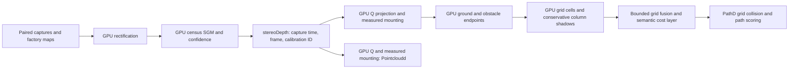

# EOP10 GPU stereo endpoint mapping

Updated 2026-10-19. This implements the local stereo-to-grid software boundary;
it is not target-board validation or permission to enable unmeasured geometry.
NGP10's shared GPU context is inherited unchanged. No other repository is edited.

## Implemented flow



The flow follows Autoware's separation of raw/ground/obstacle clouds before
probabilistic mapping. The [primary mapping reference](https://autowarefoundation.github.io/autoware.universe/main/perception/autoware_probabilistic_occupancy_grid_map/pointcloud-based-occupancy-grid-map/)
uses ray/visibility processing and unknown shadows. This code is a conservative
OpenCL camera adaptation, not imported Autoware code or a Mali port of its CUDA
implementation. It marks observed endpoints only; it does not clear whole rays.
ROS complete-Q source pins remain in STEREO_POINTCLOUD_UPSTREAM_CONTRACT.md.

GPU work includes full-image rectification, matching, Q reconstruction,
mounting transform, height classification and endpoint rasterization. CPU work
is message validation, transfer/compaction and bounded grid bookkeeping/fusion;
there is no CPU matcher, remapper or point-cloud projection fallback. Rectifier
bilinear weights use float arithmetic rather than OpenCV's quantized table;
matching quality must be checked against real rectified captures.
GPU cell reduction sends at most one obstacle representative per grid cell to
CPU object-range fusion (at most 9,000 points on this grid), rather than every
valid image pixel. Endpoint occupancy does not depend on which representative
the atomic reduction selects.

Ground endpoints are within 0.10 m of a measured local ground plane. Obstacles
are 0.18–2.5 m above it. The gap, below-ground samples and points outside the
measured operating envelope provide no evidence. These are initial validation
parameters, not tuned road/curb acceptance thresholds. Ground behind the nearest
obstacle in an image column plus a 0.5 m margin is suppressed. This deliberately
loses some visible ground; it never invents clear cells behind a parked car.
A second GPU pass projects each ground-cell footprint back into the image and
marks cells behind nearer obstacle columns as occluded. Occlusion raises semantic
road cost to unknown while retaining obstacle costs; it also removes historical
free confidence from newly hidden cells. An obstacle wins when ground and
obstacle endpoints land in the same cell, and
current obstacles override historical free confidence and semantic road cost.
No moving-track identity is required for a parked car's geometric footprint.

Stationary history decays toward unknown. Moving, stale/missing-pose and changed-
calibration cases clear unwarped history and use fresh endpoints. This avoids
persisting obstacle cells at the wrong vehicle location. It is not rolling,
motion-compensated mapping or ICP. Small pose values must be finite and valid;
retention requires <0.05 m/s on every velocity axis and <0.01 rad/s on every
angular-velocity axis, with pose age <=0.2 s.

GridD emits no road boundaries from cloud extrema: percentiles of obstacles
and default +/-3 m edges are not a measured drivable corridor. PathD retains its
model corridor and obstacle cost grid, clears stale stereo boundaries and does
not reuse stale stereo speed inputs. The unavailable scalar drivable-distance
constraint is infinity, not a default zero that would cause phantom slowing.
It does not mean unknown space is drivable. Connected free-corridor extraction
and path-specific stereo hazard scalars remain a later measured mapping step.

## Calibration provisioning

Factory maps and Q are loaded through HAL. StereoD fingerprints Q, metric T,
left rectification R1 and all four measured maps using SHA-256 over canonical
float64 arrays. `stereoDepth.calibrationId` carries this fingerprint. GridD and
Pointcloudd reject empty/different identity, wrong resolution and missing
confidence. Deploy schema changes to producer and consumers together.

Application-owned mounting lives at:

`Paths.eop_data_root()/calibration/stereo_extrinsics.npz`

Required arrays, loaded with `allow_pickle=False`:

| Key | Contract |
| --- | --- |
| `calibration_id` | Scalar text, exactly `stereo_input.calibration_id(factory_calibration)` |
| `rectified_optical_to_footprint` | Measured rigid 4x4 transform, metres, rectified optical right/down/forward to base_footprint forward/left/up |
| `ground_plane` | Four coefficients `[nx,ny,nz,d]`: unit upward normal, `n dot p + d = 0` in base_footprint |

Do not put physical unrectified left-camera extrinsics into this field. If
`T_raw` maps physical left optical coordinates to footprint and HAL's `R1`
rectifies that camera, the rectified transform has rotation
`T_raw[:3,:3] @ R1.T` and the same measured translation. Supply independently
measured values; no deployment mounting file is synthesized by this change.
Camera height must be 0.2–3 m. Ground normal z must be >=0.96, and its offset
must be within 0.2 m of footprint zero. Invalid/missing files leave the source
degraded and are retried with a two-second backoff.

The stored local ground plane is not fitted to every road slope. Bumps, ramps,
banking and mounting movement require measured validation and eventually a
validated live ground estimator; do not claim this fixed-plane model covers
those cases. No measured stereo mounting is available on this development PC.

Pointcloudd now reconstructs directly into measured footprint FLU on GPU, carries
capture timestamp/frame ID, and publishes `calibrationId`/`coordinateFrame`.
It no longer relabels a nominal optical-axis rotation as vehicle calibration.
Its cached geographic position is not interpolated capture-time localization.
Optical-only semantic association is not applied to transformed coordinates.

## Failure and resource contract

GPU/calibration/source errors produce no replacement cloud or map. GridD reports
`stereoDegraded` and `stereoDegradedReason`; absence of source flags cannot be
read as free space. Core CPU/RKNN disengagement policy is unchanged. PCIe-card
semantics remain independently degraded when unavailable. No inference moves
to CPU or RKNN to substitute for the stereo GPU.

Each stage has a completed-work deadline (50 ms here), and GridD rejects depth
older than 200 ms including GPU work. OpenCL cannot portably preempt a hung
driver. GPUGridMapper checks its combined projection/classification working
set against the shared allocator budget; rectification and SGM also have bounded
buffers. Whole-system peak memory, upload/readback overhead and contention still
need target profiling. Current stages use host readback between some kernels;
zero-copy DMA and device-resident stage chaining are not claimed.

## Verification and remaining acceptance

Host commands (NumPy, pytest, pycapnp; no compiled IPC/device imports required):

```bash
python3 common/tests/test_gpu_compute.py
python3 nagaspilot/daemons/stereod/test_stereo_runtime.py
python3 nagaspilot/daemons/pointcloudd/test_gpu_contract.py
python3 nagaspilot/daemons/gridd/test_stereo_grid_runtime.py
python3 nagaspilot/manager/tests/test_compute_fault_policy.py
```

The new host suite executes actual GridD serialization against the real Cap'n
Proto schema: a stationary parked obstacle overrides a road cost at the correct
left-positive cell, its mirrored cell stays road, and source loss clears fresh
stereo flags without publishing a zero-distance speed constraint. Calibration,
failure/retry, missing confidence, expired/duplicate capture, ground precedence,
stationary decay and moving-history clearing are covered separately.
Stereo depth, grid outputs and processed clouds explicitly set the Event valid
flag; healthy status envelopes remain valid while reporting source degradation.
Tests start from cereal.messaging's default-invalid envelope so this wiring is checked.

Required GPU acceptance commands on each actual RK3588/RK3576 target:

```bash
EOP_GPU_TESTS=1 python3 nagaspilot/daemons/stereod/test_stereo_runtime.py
EOP_GPU_TESTS=1 python3 nagaspilot/daemons/gridd/test_stereo_grid_runtime.py
```

On this PC, explicitly requested GPU checks fail with
`PLATFORM_NOT_FOUND_KHR`; they do not pass using CPU OpenCL. CL1.2 syntax and host
tests are not numerical GPU execution proof. Real camera replay, depth/obstacle
accuracy, false-free rate, road-slope behavior, calibrated mounting, concurrent
ADAS/UI latency, sustained thermals and whole-system memory remain required.
The full `./test.sh` gate still stops at the pre-existing portable-source mismatch
in `nagaspilot/runtime/bigmodel_platform.py`; that check is not bypassed.

Recorded host result (2026-10-19): 78 cases pass: shared GPU policy (5), StereoD
runtime (22), Pointcloudd contracts (14), stereo grid/wire/PathD expiry (20), core
compute policy (9), and existing metric geometry fixtures (8). The metric pytest
fixtures were loaded through a temporary standalone wrapper to avoid this PC
checkout's package/compiled-IPC import setup. Six numerical GPU cases remain
explicitly gated by default. Requesting the three new actual-GPU cases fails at
GPU acquisition with PLATFORM_NOT_FOUND_KHR. Focused ruff, Python syntax and four
CL1.2 kernel syntax checks pass. This result does not make the full gate green.
