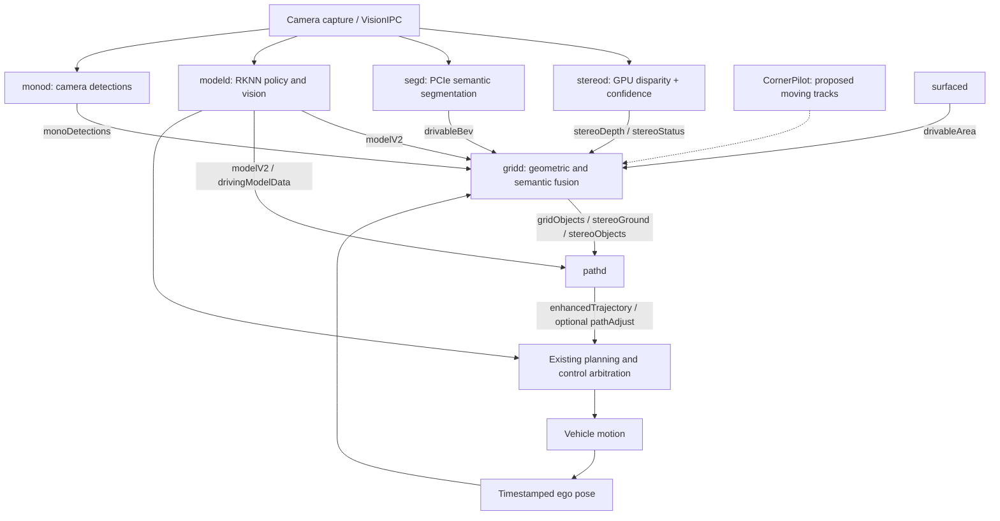

# EOP10 stereo-to-control integration audit and plan

Date: 2026-10-18. Baseline: c10706857, dev/EOP10. Documentation only.
Companion: [algorithm research](STEREO_DRIVABLE_MAPPING_RESEARCH.md).
Baseline ownership and phone-inference decisions:
[lineage and JetLink v3 task ledger](../integration/EOP10_LINEAGE_JETLINK_TASKS.md).
Shared JetLink integration begins at `nagaspilot/jetlink` on NGP10; modeld's
local fallback remains NGP/EOP-owned. EOP stereo consumes the same model outputs
regardless of which inference source is selected.

## Verdict and scope

The proposed architecture is coherent: GPU stereo supplies geometric surface
and obstacle evidence; the camera-tier card supplies road semantics; modeld
supplies driving policy and lane/road context; gridd owns perception fusion;
pathd proposes bounded adjustments; existing control arbitration retains
authority. Current source inspection does NOT establish seamless operation.
The blockers below must be resolved and validated in order.

GPU stereo is a requirement: do not silently move sustained stereo work onto
the CPU used by ADAS. If GPU depth cannot meet its measured budget, report
degraded availability and reduce configured workload within validated limits.
CPU reference algorithms are for offline validation, not automatic deployment
fallback. Proposed grid kernels also target GPU; any small CPU residual work
needs an explicit measured budget.

CornerPilot is treated as a future moving-track source, not an implemented
replacement protocol. Static occupancy must survive independently of tracks,
including when a moving object stops. Front stereo cannot prove unobserved
side/rear areas free.

## Actual graph and required contracts

| Boundary | Current implementation | Required acceptance contract |
| --- | --- | --- |
| Capture → stereod | Left/right VisionIPC receives are sequential | Exposure times, pair identity, skew limit, resolution and calibration revision checked |
| stereod → gridd | Float32 disparity/confidence bytes, dimensions and timestamp | Pixel units, explicit invalid convention, calibrated confidence, source capture time and backend health |
| segd → gridd | drivableBev on shared BEV_GRID, per-camera data | Capture time and camera calibration provenance; reject stale/invalid maps; no semantic override of occupied geometry |
| modeld → gridd/pathd | modelV2; drivingModelData policy to pathd | Calibrated forward/right/down frame, synchronized age, model validity and policy arbitration retained |
| ego pose → rolling grid | livePose forward speed used for semantic translation | Pose at capture times, yaw/translation compensation, uncertainty, reset on discontinuity |
| gridd → pathd | occupancy uint8, cost uint16 on BEV_GRID; boundaries and object list | Shape/scale/frame validation, real source freshness, explicit unknown/observed masks and confidence |
| pathd → controls | enhancedTrajectory plus optional shared rule channel | Expiration, finite bounded proposals, driver override, no new emergency-braking authority |

Grid coordinates are vehicle forward/LEFT/up; stereo optical coordinates are
right/down/forward; model/path lateral coordinates point RIGHT. Transform
exactly once at each explicit boundary, including camera extrinsics and tilt.
Messages arriving now do not imply their sensor observation is current.

## Source-by-source audit

These are source findings, not target-hardware test results. Method names are
stable lookup anchors; line numbers describe this baseline and can move.

| Priority | Source / location | Finding and planned resolution |
| --- | --- | --- |
| P0 | stereod/stereod.py: StereoD.__init__, _compute_disparity, run | Rectification maps remain None in inspected execution path; load/validate measured calibration before processing |
| P0 | stereod/sgm.py: SGM.__init__, compute | NumPy CPU backend despite GPU acquisition in caller; introduce truthful OpenCL backend dispatch through InferenceD and enforce deployment GPU requirement |
| P0 | gridd/gridd.py: _lazy_reprojection, _default_calibration | Reads Q[2,2] as focal length although local Q puts focal length at Q[2,3]; use verified homogeneous Q reprojection, with sign/units and calibrated fixtures |
| P0 | gridd/lazy_bev.py: update_from_points (423 onward) | All selected depth returns increment occupied cells without a height/ground test; add ground support vs obstacle separation before grid integration |
| P0 | gridd/gridd.py: _extract_road_boundaries (810 onward) | 5th/95th lateral point percentiles measure visible point extent, not traversable corridor; derive boundaries from connected supported free space and inflated obstacles |
| P0 | gridd/gridd.py: _publish (837 onward), pathd/pathd.py: update (838 onward) | Consumer reads bikeHazard/drivableLimitM/occupancyDetected, publisher does not explicitly populate them; define valid/unknown semantics and populate or disable dependent proposals explicitly |
| P1 | stereod/stereod.py: run / _publish | Publication time and local counter replace source exposure identity; carry source provenance and reject mismatched pairs |
| P1 | gridd/gridd.py: _lazy_reprojection | Every-fourth sampling mask leaves other offsets; select actual stride while preserving image coordinates and calibration scale |
| P1 | segd/segd.py: _publish_bev (149 onward) | frameTimestamp uses publish-time monotonic clock; retain actual camera capture timestamp through inference |
| P1 | gridd/gridd.py: _fuse_drivable_bev (309 onward) | Layout checked, but integration uses receipt time; validate source age/validity and fuse each observation once |
| P1 | gridd/drivable_fusion.py: step / _move | Forward translation only; compensate turns and pose changes before temporal fusion |
| P1 | gridd/lazy_bev.py: update_from_points | Decay happens when points arrive and occupancy has no ego-motion warp here; age every tick even through dropouts, and align accumulated obstacles |
| P1 | gridd/gridd.py: _publish | Fixed sourceFlags imply sources regardless of actual contribution; derive flags/validity from accepted fresh observations |
| P1 | pathd/pathd.py: update (808–874) | Receipt-time 0.5 s cache expiry exists, but newly republished stale fused evidence can appear fresh; propagate source age through fusion and test dropouts end to end |
| P1 | pathd/pathd.py: fuse_corridor_boundaries call | Calls fusion with modelV2 and None; trace actual stereo boundary/nudge use separately rather than assuming the corridor helper consumes stereo |
| P1 | pathd/pathd.py and runtime/pathd.py | Legacy grid tracker and shared object-source path coexist; document enabled modes and avoid duplicate tracking/adjustment authority |
| P1 | system/inferenced/kernels/occupancy_grid.cl | Float updates race; row/column layout and decay semantics need parity checks; replace with deterministic per-cell reduction |
| Preserve | gridd/fusion_costmap.py: apply_drivable / mark_occupied | Current call order stamps obstacles after semantic cost reduction; retain and test obstacle precedence |
| Preserve | pathd/pathd.py: OccupancyGridView | Explicit uint8/uint16 decoding, fixed cost normalization and lateral flip exist; retain round-trip fixtures |
| Preserve | selfdrive/controls/controlsd.py: 358 onward | Camera/path mitigation is bounded; radar AEB remains separate, lateral rule arbitration uses apply_curvature; do not bypass these paths |

Source paths above are relative to `nagaspilot/daemons/` unless otherwise
qualified. Compatibility modules under `selfdrive/` import these implementations.

### Implementation progress, 2026-10-18

The first metric-geometry slice now uses `gridd/stereo_geometry.py`: complete
homogeneous Q reprojection at original image coordinates, true every-fourth
row/column sampling and finite/confidence/range filtering. The reference rejects
missing or malformed Q rather than substituting nominal calibration. It is not
yet wired into live gridd: that path marks all selected returns occupied and
needs ground/obstacle separation before corrected depth is enabled. Output
remains optical right/down/forward; camera extrinsics, capture pairing and
calibration-resolution provenance still need integration. This is numerical
reference work, not live GPU dispatch or completed mapping.

Eight numerical fixture cases pass, covering metric scale, homogeneous offsets,
sampling, invalid depth/confidence and calibration input rejection. A separate
lineage unit case also passes. Tests ran from an isolated copy to avoid this
host's case-insensitive mount/pytest collection issue; tested helper and fixtures
were copied directly from this working tree. The required full ./test.sh gate
still stops at the pre-existing bigmodel_platform.py lineage mismatch.

Exopilot now provides `hal.gpu` with actual OpenCL GPU enumeration and an optional
kernel execution/output check (seven host policy tests pass). The development
host has no available OpenCL GPU. RK3588 supports Mali/OpenCL, but EOP's current
arm_acl.py SGM path returns zeros rather than dispatching a kernel. Real GPU
SGM and target-board profiling remain required; no working GPU stereo pipeline
is claimed. Generic external-GPU compute remains separate future work; the
removed Chestnut/eGPU driving-model path stays removed.

NavPilot's first real PLP USB-network adapter is committed separately, with 25
PLP package tests passing. App integration, service parity and JetLink native
inference remain distinct tasks; they do not block numerical stereo fixtures.

## Ordered implementation slices and completion criteria

1. **Establish reproducible baseline.** Resolve or separately account for the
   existing `./test.sh` lineage mismatch in runtime/bigmodel_platform.py. Check
   actual process registration, feature parameters and GPU/card capabilities for
   EOP10; record which optional planner modes run. No blanket test bypass.
2. **Repair metric stereo contract.** Pair frames, load measured rectification,
   validate Q and extrinsics, define pixel disparity/confidence and provenance.
   Known-distance fixtures must reproduce metric XYZ and reject bad calibration.
3. **Implement and benchmark GPU depth.** Real OpenCL dispatch, four-path SGM,
   left/right checks, device buffers, latency/health telemetry. Measure alongside
   UI and ADAS; GPU loss must not silently start CPU SGM. Select resolution,
   disparity range and rate from measured accuracy, latency and memory limits.
4. **Implement geometric evidence.** Ground model, slope/height uncertainty,
   occupied/free/unknown visibility and deterministic grid reduction. Road
   points must not become obstacles; car bodies must not become ground. Keep
   observed-space and source-age evidence separate from occupancy probability.
5. **Complete temporal fusion.** Capture-time pose alignment, yaw/translation,
   reset semantics, duplicate rejection and dropout decay. A turn must not smear
   parked vehicles into an apparently free corridor. Invalid depth stays unknown.
6. **Fuse semantics and model context.** Segmentation offers road support; model
   lanes/edges guide context. Neither clears geometric obstacles. Compare plane
   projection with stereo-ground-supported projection on hills and occlusions.
7. **Complete planner contracts.** Define valid corridor samples, conservative
   limits/hazards, vehicle-footprint clearance and unknown handling. Wire the
   intended consumers explicitly and reconcile legacy/shared planner modes.
8. **Prove closed-loop integration in replay/simulation.** Trace capture → depth
   → map → proposal → arbitration with shared provenance. Target hardware tests
   follow host fixtures; runtime capability is not established by documentation.

## Integration acceptance matrix

| Scenario | Required observable result |
| --- | --- |
| Parked car on either edge; narrow gap | Geometry removes footprint plus clearance; no moving-track identity required |
| Moving object stops / CornerPilot drops out | Static occupancy persists while recently supported; source health degrades honestly |
| Vehicle turns, climbs or changes pitch | Ground/obstacles stay aligned; uncertainty grows when pose or surface fit is weak |
| Road segmentation over a car or beyond occlusion | Geometry dominates; hidden cells remain unknown |
| Stereo loss while modeld/segd continue | Depth age increases; cached geometry expires; no fresh fixed-source flags |
| Segmentation/card loss while stereo works | Explicit semantic degradation; geometric obstacles remain represented |
| Modeld loss or stale policy | Existing control validity handling retained; perception cannot invent policy authority |
| GPU unavailable or deadline exceeded | Fault/degradation reported; no sustained CPU fallback; stale outputs rejected |
| Malformed map, wrong Q/resolution, duplicate frame | Rejected without making road free or issuing a new adjustment |
| Unknown/out-of-grid path and reverse/side motion | Explicit conservative policy; no implicit all-around coverage claim |
| Driver override / stale adjustment | Adjustment expires or yields through existing arbitration |

Record depth error versus range, obstacle recall and false-free cells, minimum
vehicle clearance, corridor jitter, source-to-control p50/p95/p99 age, dropped
frames, GPU memory/utilization, CPU budget, UI frame time and sustained thermal
behavior. Thresholds and operating envelope must be selected from recorded
sensor data and target-board measurements before acceptance. Until then this
is an implementation plan with known gaps, not a claim of driving readiness.

### GPU implementation checkpoint, 2026-10-18

NGP10 now provides `common/gpu_compute.py` (4728d8add): GPU-only enumeration,
CL1.2 compilation, in-order queue, bounded allocations and explicit smoke kernel.
EOP10 was rebased onto that baseline. InferenceClient.gpu() owns and smoke-checks
the context without initializing unrelated NPU/PCIe backends. The legacy ACL
stereo placeholder now fails instead of returning successful zero disparity.

EOP's new OpenCLStereo implements 5x5 census, reusable cost/aggregate volumes,
four independent SGM paths with both penalties, optional subpixel/median,
normalized confidence and left/right consistency. Both matching views execute
on the GPU. The matcher rejects work beyond its completed-frame deadline and
never starts CPU matching. Its 128 MiB working-set cap can reject full camera
resolution; calibrated lower-resolution capture/maps must be supplied rather
than silently resizing. OpenCL driver calls are not portably preemptible.

StereoD now requests this backend explicitly, requires factory maps at the exact
capture resolution and a metric forward-positive Q, reads padded luma rows,
rejects stale/duplicate/skewed capture timestamps, preserves camera frame/time,
and reports processingTimeMs through the existing schema. Missing calibration
or GPU produces status/fault only. The unused wide-camera dependency is removed.

Checkpoint validation: five shared host policy tests pass; changed Python files
compile and the kernel passes clang CL1.2 syntax validation. GPU numerical tests,
real camera replay, target execution/performance and full pipeline validation
remain pending. No stereo hardware is attached to this development host. The
existing full test gate remains blocked by the separately recorded baseline
bigmodel_platform.py mismatch. GPU recovery/reinitialization and calibration
resolution provisioning remain follow-up work. No driveable mapping or control
acceptance is claimed; live gridd geometry integration remains deferred.
